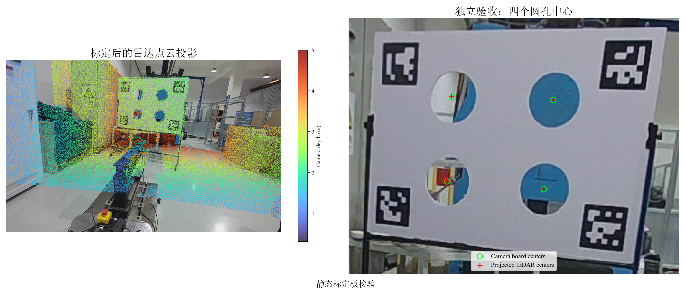
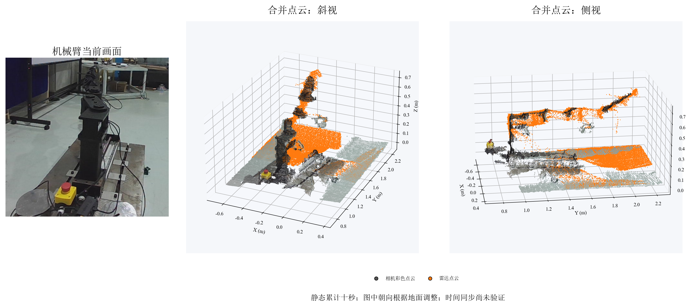
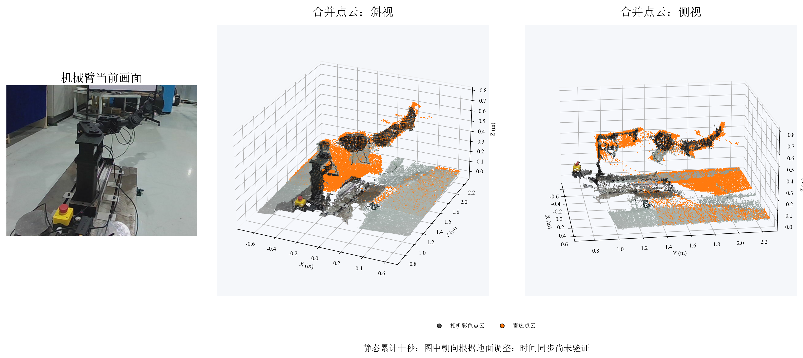

# MID-360S 与 Gemini 335L 标定记录

2026-10-26，在两个传感器相对位置和角度固定后，使用三个标定板姿态联合求解，并用另一个移动后的姿态独立验收。验收通过，结果见 [外参及误差数据](lidar_camera_20261026.json)。

## 坐标与使用

变换方向为 `livox_frame` → `camera_color_optical_frame`，长度单位为米：

```text
p_camera = R @ p_lidar + t

R = [[-0.6542635671, -0.7415855490,  0.1482904525],
     [ 0.0972200182, -0.2769298166, -0.9559592798],
     [ 0.7499916352, -0.6110325279,  0.2532820502]]
t = [-0.4015673616, -0.0444338887, 0.0599622675]
```

相机光学坐标为 X 向右、Y 向下、Z 向前。两个传感器整体移动、相对位置和角度保持不变时，这套相对外参继续适用。单独调整任一传感器后需要重新标定。

设备时间同步、运动场景误差、深度相机点云的整体一致性，以及传感器到机械臂 `base_link` 的变换尚未验证。`config/sensor_extrinsics.yaml` 的机器人基座标定状态保持原有设置。

## 数据与标定板

- 雷达：MID-360S，序列号 `ARMCP7D0030415`。
- 相机：Gemini 335L，序列号 `CP28563000GD`，彩色图像 1280×800，30 Hz。
- 每组数据保存雷达点云、压缩彩色图像、相机内参和静态坐标变换。单独保存的彩色图像及 ROS bag 共同构成本次输入，全部采用静态板面。
- 相机使用采集时的完整 `CameraInfo` 畸变系数进行 OpenCV 去畸变，之后使用原内参和零畸变参数计算板面姿态。
- 标定板尺寸来自 `/home/lsn/robot/fast-calib标定板介绍.zip`，尚无独立尺量记录。板面 1400×1000 mm，圆孔直径 240 mm，圆心水平间距 500 mm、垂直间距 400 mm。ArUco 标记边长 200 mm，中心水平间距 1100 mm、垂直间距 700 mm；字典 `DICT_6X6_250`，左上、右上、左下、右下 ID 分别为 1、2、3、4。

| 数据 | 用途 | 雷达帧数 | 有效雷达点数 | 相机最大角点误差 |
|---|---|---:|---:|---:|
| `scene03` | 初始姿态，参与求解 | 117 | 2029891 | 0.80 像素 |
| `scene04` | 转动后的姿态，参与求解 | 117 | 2029009 | 0.85 像素 |
| `scene05` | 倾斜姿态，参与求解 | 116 | 2010833 | 1.31 像素 |
| `scene06` | 移动后的独立验收姿态 | 114 | 1974726 | 1.04 像素 |

四组数据均提取到四个雷达圆孔中心和四个相机标记。雷达六组圆心间距与标称尺寸的最大差值约 5.64 mm。相机圆心由 ArUco 板面姿态及标称孔位计算；原生提取结果与独立 OpenCV PnP 计算结果也通过一致性检查。

## 独立验收

三个求解姿态的圆心三维 RMSE 为 3.38 mm。独立验收数据没有参与外参求解，验收前后求解矩阵保持一致。

| 检查项 | 验收测量值 | 接受条件 |
|---|---:|---:|
| 四圆心最大三维误差 | 9.06 mm | ≤20 mm |
| 四圆心三维 RMSE | 6.37 mm | 记录指标 |
| 板面距离第 95 百分位 | 8.66 mm | ≤20 mm |
| 圆心最大图像投影误差 | 2.05 像素 | ≤5 像素 |

图像误差比较雷达圆心投影与 ArUco 板面姿态预测的圆心。板面距离检查雷达板面点经变换后到相机预测板面的距离。结果适用于本次静态板面及测量距离。



## 本机文件与复现

数据目录为 `.scratch/lidar-camera-calibration-20261026/`。四组有效数据的 bag、图像、内参、圆心和板面点云保存在该目录；文件校验值见 [SHA-256 清单](lidar_camera_20261026_sha256.txt)。该目录被 Git 忽略，跨机器复现需要单独复制数据。

本次工具源码保存于 [tool_sources_20261026](tool_sources_20261026/)。FAST-Calib 上游版本、ROS 2 移植版本及原生提取补丁见 [工具来源](../lidar_camera_calibration.md#本机数据与复现)；本次沿用同一原生提取程序。构建目录和 Python venv 位于 `.scratch/lidar-camera-calibration/`，本次数据及参数使用新的目录。

在仓库根目录执行：

```bash
.scratch/lidar-camera-calibration/venv/bin/python \
  .scratch/lidar-camera-calibration-20261026/check_measurements.py \
  scene03 scene04 scene05 scene06

.scratch/lidar-camera-calibration/venv/bin/python \
  .scratch/lidar-camera-calibration-20261026/evaluate_calibration.py \
  --train scene03 scene04 scene05 --validation scene06 \
  --output docs/calibration/lidar_camera_20261026.json

.scratch/lidar-camera-calibration/venv/bin/python \
  .scratch/lidar-camera-calibration-20261026/apply_calibration.py \
  --calibration docs/calibration/lidar_camera_20261026.json --scene scene06

.scratch/lidar-camera-calibration/venv/bin/python \
  .scratch/lidar-camera-calibration-20261026/plot_calibration.py \
  --calibration docs/calibration/lidar_camera_20261026.json --scene scene06

.scratch/lidar-camera-calibration/venv/bin/python \
  .scratch/lidar-camera-calibration-20261026/verify_artifacts.py
```

验收数据已输出 `scene06/lidar_in_camera_frame.pcd`，共 927622 个点；`scene06/colored_lidar_in_camera_frame.pcd` 共 220179 个点。前者经过 1 cm 体素采样并变换到相机光学坐标，后者从相机视野中的雷达点读取对应图像颜色。每个像素保留距离相机最近的雷达点，设备之间的遮挡差异尚未单独评估。

点云文件已重新读取并核对变换结果、颜色范围及点集关系，工具源码快照与实际运行文件一致；检查结果见 [文件验收数据](lidar_camera_20261026_artifact_check.json)。

## 机械臂附近合并点云

沿用本次固定安装关系，重新累计十秒雷达点云，并读取一帧相机深度点云。两路数据使用本次外参统一到 `camera_color_optical_frame`，分别进行 5 mm 体素采样后合并。局部范围内包含 42662 个相机点、35369 个雷达点，合计 78031 个点；范围和采集统计见 [合并点云数据](robot_fused_cloud_20261026.json)。



相机点采用对应图像颜色，雷达点显示为橙色。三维图片根据测得的地面调整显示朝向，保存的点云仍采用相机光学坐标，机器人基座坐标关系尚未验证。完整点云和程序见 [第一组数据包](../../data/sensor_captures/20261026/pose01.tar.gz)，恢复目录为 `.scratch/fused-cloud-20261026-gyrIKgQI/`，合并文件为 `merged_camera_frame.pcd`。

两路视野和遮挡存在差异。统计文件中的最近点距离包含只有一路看到的表面，不能直接用于判定外参误差。本次图像采用静态累计，设备时间同步尚未验证。

### 机械臂弯折姿态

机械臂改变姿态后，重新采集 100 帧、1742254 个雷达点和 733737 个相机深度点。扩大右侧局部范围后，5 mm 体素采样保留 56598 个相机点、43063 个雷达点，合并为 99661 个点，统计见 [弯折姿态采集数据](robot_fused_cloud_pose02_20261026.json)。



本组完整数据和程序见 [第二组数据包](../../data/sensor_captures/20261026/pose02.tar.gz)，恢复目录为 `.scratch/fused-cloud-20261026-ITy6es0e/`，合并文件为 `merged_camera_frame.pcd`。两个传感器沿用本次标定外参；图像采用十秒静态累计。

### 两次采集的数据恢复与校验

两组数据来自当前实验室笔记本电脑，使用提交 `d65c1f5` 中的标定外参。每个数据包包含十个文件：原始两路点数组 `independent_clouds.npz`、相机画面、雷达全景图、采集内参及统计、合并统计、三份 PCD 点云，以及采集和绘图脚本。NPZ 中的雷达数组包含 XYZ 和 intensity 四列，相机数组包含 XYZ 三列。

| 数据包 | 压缩容量 | 原始雷达点数 | 原始相机点数 | 合并后局部点数 |
|---|---:|---:|---:|---:|
| `pose01.tar.gz` | 26.4 MiB | 1739594 | 728308 | 78031 |
| `pose02.tar.gz` | 26.9 MiB | 1742254 | 733737 | 99661 |

归档中的二十个文件已逐一与本机来源文件比对，原始数组维度、有效数值、三份点云的点数和颜色、图像尺寸均通过检查。详细结果见 [归档检查记录](robot_fused_cloud_20261026_archive_check.json)，文件摘要见 [SHA-256 清单](robot_fused_cloud_20261026_sha256.txt)。

在仓库根目录恢复数据：

```bash
sha256sum -c docs/calibration/robot_fused_cloud_20261026_sha256.txt
mkdir -p .scratch
tar -xzf data/sensor_captures/20261026/pose01.tar.gz -C .scratch
tar -xzf data/sensor_captures/20261026/pose02.tar.gz -C .scratch

.scratch/lidar-camera-calibration/venv/bin/python \
  data/sensor_captures/20261026/verify_captures.py

.scratch/lidar-camera-calibration/venv/bin/python \
  .scratch/fused-cloud-20261026-gyrIKgQI/render_fusion.py

.scratch/lidar-camera-calibration/venv/bin/python \
  .scratch/fused-cloud-20261026-ITy6es0e/render_fusion.py
```

另一台机器需准备 NumPy、OpenCV、Open3D、Matplotlib、SciPy，以及 SimSun 和 Times New Roman 字体；Python 环境按该机器的安装位置使用。点云数据校验和出图使用保存的数据，不需要连接传感器。
