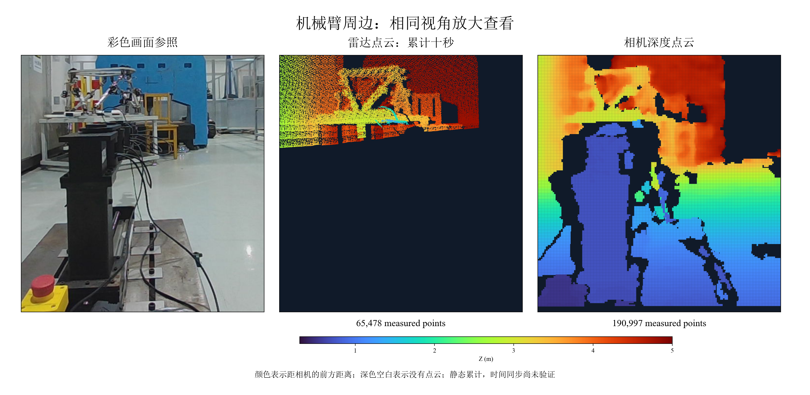

# MID-360S 与 Gemini 335L 相对外参

当前安装关系的标定结果见 [2026-10-26 标定记录](calibration/lidar_camera_20261026.md)和[外参及独立验收数据](calibration/lidar_camera_20261026.json)。

## 2026-10-21 测量记录

2026-10-21 使用固定于同一支架的 MID-360S 与 Gemini 335L 完成静态标定板外参测量。三个不同板面姿态参与求解，另一个移动后的姿态用于独立检验。结果保存在 [外参与验证数据](calibration/lidar_camera_20261021.json)。

### 坐标与使用范围

矩阵将 `livox_frame` 中的点变换到 `camera_color_optical_frame`，长度单位为米：`p_camera = R @ p_lidar + t`。相机坐标采用光学坐标：X 向右，Y 向下，Z 向前。

```text
R = [[-0.9316335534, -0.3598655089, -0.0505543038],
     [ 0.0399663563,  0.0368071672, -0.9985228704],
     [ 0.3611947016, -0.9322778813, -0.0199082789]]
t = [-0.1930028903, -0.0680134276, -0.0273417612]
```

两个传感器的相对位置、角度保持不变时，该相对外参可继续使用。整体移动三脚架会改变传感器相对机械臂的位置，需要重新确定与 `base_link` 的关系。调整任何一个传感器的安装角度或位置后，需要重新标定相对外参。

本次检查静态目标的空间变换。设备时间同步、运动目标误差、深度相机点云与雷达点云的整体一致性尚未验证。彩色图像投影使用 `camera_color_optical_frame`；其他相机坐标系必须通过设备提供的对应变换转换。当前项目 `config/sensor_extrinsics.yaml` 中的 `base_link` 标定状态仍待完成。

### 测量条件

- 雷达序列号 `ARMCP7D0030415`，相机序列号 `CP28563000GD`。
- 彩色图像 1280×800，30 Hz；雷达约 10 Hz。相机内参和完整畸变系数从本次设备 `CameraInfo` 读取，图像经过 OpenCV 去畸变。
- 标定板尺寸来自用户提供的 `/home/lsn/robot/fast-calib标定板介绍.zip`，尚无独立尺量记录。
- 板面 1400×1000 mm，圆孔直径 240 mm，圆心水平间距 500 mm、垂直间距 400 mm。
- ArUco 标记边长 200 mm，中心水平间距 1100 mm、垂直间距 700 mm；字典 `DICT_6X6_250`，左上、右上、左下、右下 ID 分别为 1、2、3、4。
- 有效求解数据为 `scene04`、`scene05`、`scene06`；独立验收为 `scene07`。所有姿态均在传感器安装关系固定后采集。

### 验证结果

训练数据圆心 RMSE 为 7.36 mm。独立验收结果如下：

| 检查项 | 测量值 | 本次接受条件 |
|---|---:|---:|
| 四圆心最大三维误差 | 16.77 mm | ≤20 mm |
| 四圆心三维 RMSE | 12.45 mm | 记录指标 |
| 板面距离第 95 百分位 | 15.03 mm | ≤20 mm |
| 圆心最大图像投影误差 | 3.69 像素 | ≤5 像素 |

圆心图像误差比较雷达圆心投影与 ArUco 板面姿态预测的圆心位置。结果受到设备测量误差、标记打印尺寸、板面平整程度和圆孔提取误差共同影响；这些数字适用于本次静态板面数据，尚未测量其他距离和运动状态。

### 本机数据与复现

数据、提取程序和日志位于仓库的 `.scratch/lidar-camera-calibration/`，该目录被 Git 忽略，跨机器使用需要另外复制。每组目录保存 ROS bag、`xyz.npy`、去畸变图和检查信息；对应 `sceneXX-result/` 保存提取的圆心和板面点云。

工具基于 FAST-Calib commit `1018ecfdf9deda51b91a8a11bd11972a0b159008` 和 ROS 2 移植 commit `78202f66b3d3b3c69e44a80a7c0b93919f07d607`。本地提取程序使用单位旋转、完整四圆心检查及圆周覆盖检查。最终矩阵由多姿态圆心对应关系搜索与刚体拟合生成，使用 JSON 文件作为本次外参结果。

在仓库根目录执行：

```bash
.scratch/lidar-camera-calibration/venv/bin/python \
  .scratch/lidar-camera-calibration/evaluate_calibration.py \
  --train scene04 scene05 scene06 --validation scene07 \
  --output docs/calibration/lidar_camera_20261021.json

.scratch/lidar-camera-calibration/venv/bin/python \
  .scratch/lidar-camera-calibration/apply_calibration.py \
  --calibration docs/calibration/lidar_camera_20261021.json --scene scene07
```

第二条命令将验收数据的雷达点云变换到相机光学坐标系，写入 `scene07/lidar_in_camera_frame.pcd`，并生成 `scene07/colored_lidar_in_camera_frame.pcd`。着色使用静态场景图像，按相机视野筛选雷达点并保留每个像素的最近雷达点；该过程尚未评估两个传感器之间的遮挡差异。

### 机械臂周边采集与接手

当前设备为实验室笔记本，项目路径 `/home/lsn/robot/robot_safecontrol`，同步分支为 `codex/static-obstacle-experiments`。设备网络和采集使用 ROS 2 Humble。雷达地址 `192.168.1.115`，有线主机地址 `192.168.1.5/32`，通过目标主机路由连接；无线地址为 `192.168.1.116`。

用户整体移动了相机和雷达，并确认相对位置及角度保持不变。最后一次静态累计约十秒，接收 99 帧、1612330 个雷达点；机械臂图像区域内有 65478 个雷达投影点，详情见 [采集统计](calibration/robot_surroundings_capture.json)。



当前观测仍缺少前方支座下部。测量到的雷达最低仰角约为 −8.15°；依据相机深度点和相对外参计算，支座下部所需仰角的第 5、50、95 百分位约为 −33.38°、−26.05°、−16.29°。后续需要继续调整整体安装高度或朝向并重新检查覆盖。单独移动任一传感器后须重新标定相对外参。

本次执行过的工具源码快照位于 [tool_sources](calibration/tool_sources/)，包含采集、图像生成、圆心验证和点云变换程序，以及本地 FAST-Calib ROS 2 修改补丁。工具按本次数据目录布局运行，恢复到 `.scratch/lidar-camera-calibration/` 后使用，源码快照目录本身不作为运行目录：

```bash
mkdir -p .scratch/lidar-camera-calibration
cp docs/calibration/tool_sources/*.py docs/calibration/tool_sources/*.sh \
  docs/calibration/tool_sources/*.yaml .scratch/lidar-camera-calibration/
source /opt/ros/humble/setup.bash
PYTHONNOUSERSITE=1 python3 .scratch/lidar-camera-calibration/capture_dense_surroundings.py
PYTHONNOUSERSITE=1 python3 .scratch/lidar-camera-calibration/plot_dense_surroundings.py
```

运行前需要 `/livox/lidar`、`/camera/depth_registered/points` 和 `/camera/color/image_raw` 持续发布，并恢复 `scene07/inspection.json` 中的本次相机参数。系统 Python 使用 ROS、NumPy、OpenCV、cv_bridge 和 Matplotlib；评估程序使用本地 venv 的 Open3D、SciPy 和 OpenCV。绘图字体路径写在工具中，需要安装 SimSun 和 Times New Roman。FAST-Calib 补丁对应前述 ROS 2 移植提交，构建环境需要 ROS 2 Humble、PCL、Eigen 和 OpenCV。

补丁采用无上下文格式，在对应版本的 FAST-Calib ROS 2 源码目录使用 `git apply --unidiff-zero` 加补丁文件绝对路径应用。

四组有效姿态的原始 SQLite bag 加最后一次累计点云共五个文件，约 398 MiB，留在本机 `.scratch/lidar-camera-calibration/`。其 SHA-256 见 [原始数据校验清单](calibration/local_data_sha256.txt)，在仓库根目录执行 `sha256sum -c docs/calibration/local_data_sha256.txt` 可核对。其他图像、内参、提取结果与日志也保存在同一目录；另一台机器重算外参需要复制该目录中的场景数据和提取结果，重新建立依赖环境。

已实际完成联合标定、独立验收、点云文件重新读取、十秒点云累计和图片生成。缺少四圆心的真实数据会被评估程序拒绝。时间同步、动态场景、机械臂基坐标变换以及调整后的完整下方覆盖仍待验证。
