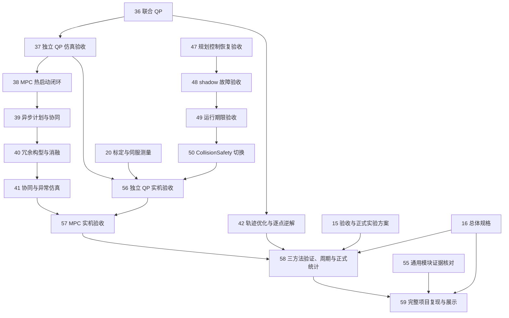

# 任务编号与阻塞关系

[完整项目地图](https://github.com/Shiningliu1011/nineaxis_safecontrol/issues/147)管理 **59 项主线任务**。标题采用 **01–59 连续编号**，按前置关系排序；GitHub issue 编号用于保持原链接与评论。

读取方法：某项任务的全部开放前置完成后，才能领取该任务。任务编号表达依赖顺序，各条独立路线可以同时推进。主表列出地图内全部直接前置，文末补充 19 条指向已完成来源任务的依赖；GitHub 原生 blocking 是状态依据。

## 主要汇合关系

下图选取两条主要路线的真实依赖边。每项任务的全部前置见后面的表格。

## 准备与设计

| 任务 | 直接前置 |
|---|---|
| [01 核验完整项目基线与 M01–M12 资产](https://github.com/Shiningliu1011/nineaxis_safecontrol/issues/148) | 无 |
| [02 取得完整工件、路径与 MATLAB 程序资产](https://github.com/Shiningliu1011/nineaxis_safecontrol/issues/135) | 无 |
| [03 激光雷达外参标定与独立验收并写入真源](https://github.com/Shiningliu1011/nineaxis_safecontrol/issues/95) | 无；已领取，需要现场证据 |
| [04 完整项目技术复用与实施依赖](https://github.com/Shiningliu1011/nineaxis_safecontrol/issues/149) | 01 基线与资产 |
| [05 M02 九轴模型、TCP 与标定接口](https://github.com/Shiningliu1011/nineaxis_safecontrol/issues/136) | 01 基线与资产 |
| [06 M01 工件路径与五维任务参考](https://github.com/Shiningliu1011/nineaxis_safecontrol/issues/137) | 02 程序资产；05 模型接口 |
| [07 M07 公共限制与完整作业容差](https://github.com/Shiningliu1011/nineaxis_safecontrol/issues/138) | 06 路径参考 |
| [08 M03/M04 场景与预测碰撞接口](https://github.com/Shiningliu1011/nineaxis_safecontrol/issues/139) | 07 公共限制 |
| [09 M06 执行记录与共享进度结算](https://github.com/Shiningliu1011/nineaxis_safecontrol/issues/141) | 06 路径参考 |
| [10 全模块数据、时间与计划有效性](https://github.com/Shiningliu1011/nineaxis_safecontrol/issues/142) | 08 碰撞接口；09 进度结算 |
| [11 Runtime、安全监督与真实执行准入](https://github.com/Shiningliu1011/nineaxis_safecontrol/issues/151) | 01 基线；09 进度结算；10 数据与时间 |
| [12 M08 联合预测模型与求解方案](https://github.com/Shiningliu1011/nineaxis_safecontrol/issues/150) | 04 复用；05 模型；06 路径；07 限制；08 碰撞；10 数据与时间 |
| [13 初始逆解、入场退出与轨迹优化范围](https://github.com/Shiningliu1011/nineaxis_safecontrol/issues/140) | 04 复用；08 碰撞接口；09 进度结算 |
| [14 M09 联合 QP 与独立、协同运行规则](https://github.com/Shiningliu1011/nineaxis_safecontrol/issues/143) | 10 数据与时间；13 入场及轨迹范围 |
| [15 全项目验收、M12 与正式实验](https://github.com/Shiningliu1011/nineaxis_safecontrol/issues/144) | 14 联合 QP 定义 |
| [16 冗余机械臂预测协调控制总体项目规格](https://github.com/Shiningliu1011/nineaxis_safecontrol/issues/145) | 04 复用；11 执行准入；12 MPC 定义；15 验收方案 |

## 公共模块与独立闭环

| 任务 | 直接前置 |
|---|---|
| [17 实现 M01 工件、画笔、NURBS 与路径参考](https://github.com/Shiningliu1011/nineaxis_safecontrol/issues/152) | 02 程序资产；04 复用；06 路径定义 |
| [18 实现 M02/M07 共用模型、导数与约束](https://github.com/Shiningliu1011/nineaxis_safecontrol/issues/153) | 04 复用；05 模型；07 限制 |
| [19 实现 M11 真实设备协议与执行保护](https://github.com/Shiningliu1011/nineaxis_safecontrol/issues/164) | 01 基线；11 执行准入 |
| [20 完成 TCP、工件标定与伺服时序测量](https://github.com/Shiningliu1011/nineaxis_safecontrol/issues/165) | 11 执行准入；18 模型；19 设备协议 |
| [21 建立 LiDAR occupied/free/unknown 场景与固定模型并集](https://github.com/Shiningliu1011/nineaxis_safecontrol/issues/108) | 04 复用 |
| [22 实现逐点时间 mesh ray self-filter](https://github.com/Shiningliu1011/nineaxis_safecontrol/issues/105) | 04 复用；21 占据场景 |
| [23 建立动态 tracking 与 reachable support tube](https://github.com/Shiningliu1011/nineaxis_safecontrol/issues/101) | 04 复用；21 占据场景 |
| [24 实现 collision_scene_server 与双缓冲共享场景](https://github.com/Shiningliu1011/nineaxis_safecontrol/issues/104) | 04 复用；21 占据场景；22 自体过滤；23 动态 support |
| [25 实现独立 primitive query 行与固定容量活动集合](https://github.com/Shiningliu1011/nineaxis_safecontrol/issues/112) | 04 复用；23 动态 support |
| [26 实现自适应连续区间 certify](https://github.com/Shiningliu1011/nineaxis_safecontrol/issues/113) | 04 复用；23 动态 support |
| [27 独立几何与 kernel 正确性验收](https://github.com/Shiningliu1011/nineaxis_safecontrol/issues/125) | 04 复用；25 query；26 certify |
| [28 实现 M03/M04 工件场景与预测碰撞接入](https://github.com/Shiningliu1011/nineaxis_safecontrol/issues/154) | 08 碰撞定义；18 模型；25 query；26 certify |
| [29 实现 JAX multi-start IK 目标集合](https://github.com/Shiningliu1011/nineaxis_safecontrol/issues/111) | 04 复用；25 query |
| [30 实现共享 CollisionSafety 的九轴 AEB-RRT*](https://github.com/Shiningliu1011/nineaxis_safecontrol/issues/115) | 04 复用；26 certify；29 IK |
| [31 接入不可松弛碰撞 CBF 行与 deadline 准入](https://github.com/Shiningliu1011/nineaxis_safecontrol/issues/118) | 04 复用；24 场景服务；25 query |
| [32 实现 M05 状态快照与 M06 执行进度结算](https://github.com/Shiningliu1011/nineaxis_safecontrol/issues/155) | 09 进度定义；10 数据与时间 |
| [33 实现 M10/M11 仿真执行与最终指令校验](https://github.com/Shiningliu1011/nineaxis_safecontrol/issues/156) | 10 数据与时间；11 执行准入 |
| [34 实现独立作业 Runtime 与安全入场退出](https://github.com/Shiningliu1011/nineaxis_safecontrol/issues/158) | 13 入场定义；29 IK；30 AEB-RRT*；32 进度；33 执行 |
| [35 实现 M12 记录、回放与整段评价](https://github.com/Shiningliu1011/nineaxis_safecontrol/issues/159) | 10 数据与时间；15 验收方案 |
| [36 实现 M09 五维任务与进度联合 QP](https://github.com/Shiningliu1011/nineaxis_safecontrol/issues/157) | 14 QP 定义；17 路径；18 模型；28 工件碰撞；31 CBF；32 进度；33 执行 |
| [37 验收独立 QP 完整曲面仿真闭环](https://github.com/Shiningliu1011/nineaxis_safecontrol/issues/160) | 27 几何验收；34 Runtime；35 记录；36 QP |

## 预测协同与通用安全验收

| 任务 | 直接前置 |
|---|---|
| [38 实现 M08 联合 MPC 与热启动闭环](https://github.com/Shiningliu1011/nineaxis_safecontrol/issues/161) | 12 MPC 定义；37 独立 QP 验收 |
| [39 实现异步计划接收与上下层协同](https://github.com/Shiningliu1011/nineaxis_safecontrol/issues/162) | 10 数据与时间；34 Runtime；38 MPC |
| [40 实现未来冗余构型优化与消融入口](https://github.com/Shiningliu1011/nineaxis_safecontrol/issues/163) | 39 异步协同 |
| [41 验收双速率协同与动态异常仿真](https://github.com/Shiningliu1011/nineaxis_safecontrol/issues/166) | 23 动态 support；40 冗余构型 |
| [42 实现完整任务轨迹优化与逐点逆解比较方法](https://github.com/Shiningliu1011/nineaxis_safecontrol/issues/110) | 04 复用；13 适用范围；26 certify；30 AEB-RRT*；36 共用运动与参考协调 |
| [43 接入最新场景复查、执行前视与风险触发重规划](https://github.com/Shiningliu1011/nineaxis_safecontrol/issues/116) | 04 复用；13 适用范围；24 场景；26 certify；42 轨迹优化 |
| [44 实现碰撞故障锁存与受限恢复](https://github.com/Shiningliu1011/nineaxis_safecontrol/issues/114) | 04 复用；26 certify；31 CBF；43 前视重规划 |
| [45 测量并冻结 CollisionParameterArtifact](https://github.com/Shiningliu1011/nineaxis_safecontrol/issues/117) | 03 外参标定；04 复用；24 场景；25 query；26 certify |
| [46 真实 LiDAR 回放与共享场景验收](https://github.com/Shiningliu1011/nineaxis_safecontrol/issues/122) | 04 复用；22 自体过滤；23 动态 support；24 场景；45 参数测量 |
| [47 MuJoCo 规划控制恢复闭环验收](https://github.com/Shiningliu1011/nineaxis_safecontrol/issues/127) | 04 复用；27 几何验收；31 CBF；43 前视；44 恢复；45 参数；46 回放 |
| [48 shadow 对照与故障注入验收](https://github.com/Shiningliu1011/nineaxis_safecontrol/issues/121) | 04 复用；47 规划控制验收 |
| [49 目标计算设备 deadline 与证据 manifest 验收](https://github.com/Shiningliu1011/nineaxis_safecontrol/issues/119) | 04 复用；45 参数；48 shadow |
| [50 切换 CollisionSafety 为唯一碰撞来源](https://github.com/Shiningliu1011/nineaxis_safecontrol/issues/123) | 04 复用；49 期限验收 |
| [51 移除旧碰撞运行路径与 fallback](https://github.com/Shiningliu1011/nineaxis_safecontrol/issues/124) | 04 复用；50 切换 |
| [52 同步速度级 OSCBF 基础模块文档](https://github.com/Shiningliu1011/nineaxis_safecontrol/issues/132) | 03 外参标定；已领取 |
| [53 同步 CollisionSafety 文档与配置入口](https://github.com/Shiningliu1011/nineaxis_safecontrol/issues/120) | 04 复用；51 旧路径处理；52 基础文档 |
| [54 核对速度级 OSCBF 基础模块证据](https://github.com/Shiningliu1011/nineaxis_safecontrol/issues/129) | 04 复用；52 基础文档 |
| [55 核对通用 OSCBF 与 CollisionSafety 证据](https://github.com/Shiningliu1011/nineaxis_safecontrol/issues/126) | 04 复用；53 碰撞文档；54 基础证据 |

轨迹优化与前视任务的适用范围由“完整项目技术复用与实施依赖”和“初始逆解、入场退出与轨迹优化范围”确定。基础独立 QP 与 MPC 的依赖没有经过完整离线轨迹优化任务。

## 实机、实验与交付

| 任务 | 直接前置 |
|---|---|
| [56 验收低速独立 QP 实机作业](https://github.com/Shiningliu1011/nineaxis_safecontrol/issues/167) | 03 外参；20 设备测量；37 独立 QP；45 参数；50 CollisionSafety 切换 |
| [57 验收 MPC 协同实机与受控动态作业](https://github.com/Shiningliu1011/nineaxis_safecontrol/issues/168) | 41 协同仿真；56 独立实机 |

## 全项目正式实验与交付

| 任务 | 直接前置 |
|---|---|
| [58 完成三方法验证、周期测量与正式统计实验](https://github.com/Shiningliu1011/nineaxis_safecontrol/issues/169) | 15 实验方案；16 总体规格；42 逐点逆解；57 协同实机 |
| [59 验收完整项目复现与个人成果展示](https://github.com/Shiningliu1011/nineaxis_safecontrol/issues/170) | 16 总体规格；55 通用模块证据；58 正式实验 |

58 的前置分别提供方法实现、统一验收方案、总体要求和协同实机证据。任务内依次核查三方法共同条件、完成目标设备周期测量、固定正式清单与容量、采集及统计。测量未通过时保持开放。59 汇合控制实验、通用模块证据和总体需求，核对完整交付。

## 已完成的外部前置

以下 19 条原生依赖指向已关闭的来源任务，当前开放阻塞数为零。它们保留原实现和决定的追溯关系。

| 当前任务 | 已完成来源任务 |
|---|---|
| #108 | #100 |
| #105 | #106 |
| #101 | #109 |
| #104 | #93、#100 |
| #112 | #100、#107、#109 |
| #113 | #100、#107、#109 |
| #125 | #106、#107、#109 |
| #132 | #85、#93、#128、#130、#131 |

## 当前可推进的入口

- [[01] 核验完整项目基线与 M01–M12 资产](https://github.com/Shiningliu1011/nineaxis_safecontrol/issues/148)：已完成，证据见[基线核验](baseline-audit.md)。
- [[02] 取得完整工件、路径与 MATLAB 程序资产](https://github.com/Shiningliu1011/nineaxis_safecontrol/issues/135)：已完成，证据见[资产核验](asset-inventory.md)和[Python 运行入口](../../pipe_assets.md)。
- [[04] 完整项目技术复用与实施依赖（需你拍板）](https://github.com/Shiningliu1011/nineaxis_safecontrol/issues/149)：用户已确认复用、补充与验收安排，任务完成。
- [[05] M02 九轴模型、TCP 与标定接口（需你拍板）](https://github.com/Shiningliu1011/nineaxis_safecontrol/issues/136)：用户已确认采用现有九自由度机械臂，模型、TCP、工具轴与标定接口围绕该机构实施，任务完成。
- [[06] M01 工件路径与五维任务参考（需你拍板）](https://github.com/Shiningliu1011/nineaxis_safecontrol/issues/137)：用户已指定现有蝴蝶曲线，缺少信息由新 NURBS 程序生成新文件，任务完成。
- [[07] M07 公共限制与完整作业容差（需你拍板）](https://github.com/Shiningliu1011/nineaxis_safecontrol/issues/138)、[[09] M06 执行记录与共享进度结算（需你拍板）](https://github.com/Shiningliu1011/nineaxis_safecontrol/issues/141)：用户已确认完整方案，任务完成。
- [[08] M03/M04 场景与预测碰撞接口（需你拍板）](https://github.com/Shiningliu1011/nineaxis_safecontrol/issues/139)：[完整方案](decision-139-scene.md)已经用户确认，任务完成。
- [[10] 全模块数据、时间与计划有效性（需你拍板）](https://github.com/Shiningliu1011/nineaxis_safecontrol/issues/142)、[[13] 初始逆解、入场退出与轨迹优化范围（需你拍板）](https://github.com/Shiningliu1011/nineaxis_safecontrol/issues/140)：用户已确认并完成，分别见[共同数据与时间](decision-142-data-time.md)、[入场与比较方法](decision-140-entry-methods.md)。
- [[11] Runtime、安全监督与真实执行准入（需你拍板）](https://github.com/Shiningliu1011/nineaxis_safecontrol/issues/151)：[完整Runtime方案](decision-151-runtime.md)已经用户确认，任务完成。
- [[12] M08 联合预测模型与求解方案（需你拍板）](https://github.com/Shiningliu1011/nineaxis_safecontrol/issues/150)：本轮[真实模型、导数及求解器研究](mpc-solver-research.md)已保存，完整约束、选型及周期仍待测量，任务保持开放。
- [[14] M09 联合 QP 与独立、协同运行规则（需你拍板）](https://github.com/Shiningliu1011/nineaxis_safecontrol/issues/143)、[[15] 全项目验收、M12 与正式实验（需你拍板）](https://github.com/Shiningliu1011/nineaxis_safecontrol/issues/144)：用户已确认并完成，分别见[共同QP](decision-143-joint-qp.md)、[验收与正式实验](decision-144-acceptance.md)。
- [[19] 实现 M11 真实设备协议与执行保护](https://github.com/Shiningliu1011/nineaxis_safecontrol/issues/164)：已经解除阻塞，尚未开始实现，处于待领取状态。
- [[32] 实现 M05 状态快照与M06执行进度结算](https://github.com/Shiningliu1011/nineaxis_safecontrol/issues/155)、[[33] 实现 M10/M11 仿真执行与最终指令校验](https://github.com/Shiningliu1011/nineaxis_safecontrol/issues/156)、[[35] 实现 M12 记录、回放与整段评价](https://github.com/Shiningliu1011/nineaxis_safecontrol/issues/159)：已经解除阻塞，可以领取。
- [[17] 实现 M01 工件、画笔、NURBS 与路径参考](https://github.com/Shiningliu1011/nineaxis_safecontrol/issues/152)：已完成main集成与验收，两份包各14992原样本核验及90项直接消费者通过；[完成记录](https://github.com/Shiningliu1011/nineaxis_safecontrol/issues/152#issuecomment-6445339517)保留全部功能、跳过和各CPU计时条件。
- [[18] 实现 M02/M07 共用模型、导数与约束](https://github.com/Shiningliu1011/nineaxis_safecontrol/issues/153)：已完成main集成，79项相关检查、隔离安装与独立双线审查通过，任务完成。
- [[21] 建立 LiDAR occupied/free/unknown 场景与固定模型并集](https://github.com/Shiningliu1011/nineaxis_safecontrol/issues/108)：已集成main工作区，272项回归和两路独立审查通过，任务完成。
- [[22] 实现逐点时间 mesh ray self-filter](https://github.com/Shiningliu1011/nineaxis_safecontrol/issues/105)：已完成main集成与验收，311项相关检查和安装后真实导入通过，见[完成记录](https://github.com/Shiningliu1011/nineaxis_safecontrol/issues/105#issuecomment-6445352584)。
- [[23] 建立动态 tracking 与 reachable support tube](https://github.com/Shiningliu1011/nineaxis_safecontrol/issues/101)：已完成main集成与独立双线审查，456项相关消费者、30项独立及组合检查、43项安装公开检查通过，见[完成记录](https://github.com/Shiningliu1011/nineaxis_safecontrol/issues/101#issuecomment-6446396500)。
- [[24] 实现 collision_scene_server 与双缓冲共享场景](https://github.com/Shiningliu1011/nineaxis_safecontrol/issues/104)、[[25] 实现独立 primitive query 行与固定容量活动集合](https://github.com/Shiningliu1011/nineaxis_safecontrol/issues/112)、[[26] 实现自适应连续区间 certify](https://github.com/Shiningliu1011/nineaxis_safecontrol/issues/113)：已经解除阻塞，处于待领取状态，本轮未启动。
- #95 激光雷达外参标定：没有开放前置，由 `lsn`（GitHub `Shiningliu1011`）继续。
- #132 基础文档：已指派，等待 #95；#145 总体规格已指派，等待 #150。

当前原生快照`frontier-after-101-105-152.json`为59项主线、179条依赖、41项开放，其中32项仍有开放前置；图无循环且原生摘要一致。本轮已完成当前并行实现与#150研究记录，按用户要求停止，后续任务未启动。编号01–57的主线范围与相互关系保持现有定义；58、59负责最终汇合。#171、#182、#183已取消并移出地图，#172–#181的完成记录见[前期证据](../../static_obstacle_experiments_handoff.md)。

仓库由 `lsn` 一人跨设备使用。assignee 表示当前正在跟进的任务；未指派任务属于项目待办。
