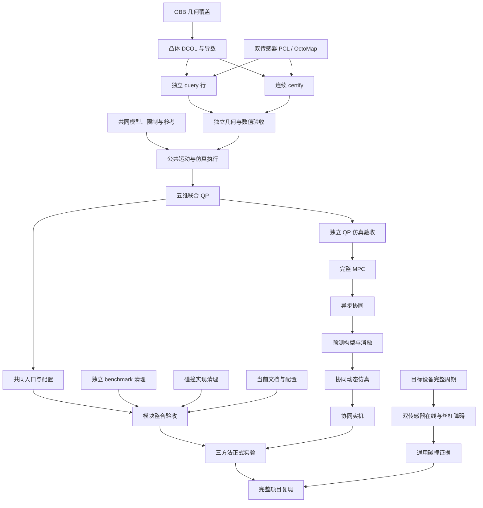

# 任务编号与阻塞关系

[完整项目地图](https://github.com/Shiningliu1011/nineaxis_safecontrol/issues/147)管理 **67 项主线任务、239 条直接前置**。编号 01–67 保持任务身份；实施顺序以 GitHub 原生依赖为准。

[DCOL 与双传感器规格](../../specs/dcol-collision-core.md)及[模块边界与清理规格](../../specs/module-boundaries-and-reuse.md)在各自范围内采用当前要求。开放任务的正文、验收和前置同步维护，已完成任务保留原证据。规格是需求来源，其关闭状态不作为新实施任务的原生前置。

## 主要关系

箭头从前置指向后续任务，图中选择主要直接关系；完整前置见表格。

## 全部直接前置

表内名称对应 GitHub 任务。多项前置分别成立；已完成来源仍保留身份。完整实时周期、参数和现场证据按各任务的适用模式取得。

| 任务 | 直接前置 |
|---|---|
| [01 核验完整项目基线与 M01–M12 资产](https://github.com/Shiningliu1011/nineaxis_safecontrol/issues/148) | 无 |
| [02 取得完整工件、路径与 MATLAB 程序资产](https://github.com/Shiningliu1011/nineaxis_safecontrol/issues/135) | 无 |
| [03 完成双传感器基座外参、时间核验与独立验收](https://github.com/Shiningliu1011/nineaxis_safecontrol/issues/95) | 无 |
| [04 完整项目技术复用与实施依赖（需你拍板）](https://github.com/Shiningliu1011/nineaxis_safecontrol/issues/149) | 01 核验完整项目基线与 M01–M12 资产 |
| [05 M02 九轴模型、TCP 与标定接口（需你拍板）](https://github.com/Shiningliu1011/nineaxis_safecontrol/issues/136) | 01 核验完整项目基线与 M01–M12 资产 |
| [06 M01 工件路径与五维任务参考（需你拍板）](https://github.com/Shiningliu1011/nineaxis_safecontrol/issues/137) | 02 取得完整工件、路径与 MATLAB 程序资产；05 M02 九轴模型、TCP 与标定接口（需你拍板） |
| [07 M07 公共限制与完整作业容差（需你拍板）](https://github.com/Shiningliu1011/nineaxis_safecontrol/issues/138) | 06 M01 工件路径与五维任务参考（需你拍板） |
| [08 M03/M04 场景与预测碰撞接口（需你拍板）](https://github.com/Shiningliu1011/nineaxis_safecontrol/issues/139) | 07 M07 公共限制与完整作业容差（需你拍板） |
| [09 M06 执行记录与共享进度结算（需你拍板）](https://github.com/Shiningliu1011/nineaxis_safecontrol/issues/141) | 06 M01 工件路径与五维任务参考（需你拍板） |
| [10 全模块数据、时间与计划有效性（需你拍板）](https://github.com/Shiningliu1011/nineaxis_safecontrol/issues/142) | 08 M03/M04 场景与预测碰撞接口（需你拍板）；09 M06 执行记录与共享进度结算（需你拍板） |
| [11 Runtime、安全监督与真实执行准入（需你拍板）](https://github.com/Shiningliu1011/nineaxis_safecontrol/issues/151) | 09 M06 执行记录与共享进度结算（需你拍板）；10 全模块数据、时间与计划有效性（需你拍板）；01 核验完整项目基线与 M01–M12 资产 |
| [12 M08 联合预测模型与求解方案（需你拍板）](https://github.com/Shiningliu1011/nineaxis_safecontrol/issues/150) | 05 M02 九轴模型、TCP 与标定接口（需你拍板）；06 M01 工件路径与五维任务参考（需你拍板）；07 M07 公共限制与完整作业容差（需你拍板）；08 M03/M04 场景与预测碰撞接口（需你拍板）；10 全模块数据、时间与计划有效性（需你拍板）；04 完整项目技术复用与实施依赖（需你拍板） |
| [13 初始逆解、入场退出与轨迹优化范围（需你拍板）](https://github.com/Shiningliu1011/nineaxis_safecontrol/issues/140) | 08 M03/M04 场景与预测碰撞接口（需你拍板）；09 M06 执行记录与共享进度结算（需你拍板）；04 完整项目技术复用与实施依赖（需你拍板） |
| [14 M09 联合 QP 与独立、协同运行规则（需你拍板）](https://github.com/Shiningliu1011/nineaxis_safecontrol/issues/143) | 13 初始逆解、入场退出与轨迹优化范围（需你拍板）；10 全模块数据、时间与计划有效性（需你拍板） |
| [15 全项目验收、M12 与正式实验（需你拍板）](https://github.com/Shiningliu1011/nineaxis_safecontrol/issues/144) | 14 M09 联合 QP 与独立、协同运行规则（需你拍板） |
| [16 冗余机械臂预测协调控制总体项目规格](https://github.com/Shiningliu1011/nineaxis_safecontrol/issues/145) | 15 全项目验收、M12 与正式实验（需你拍板）；04 完整项目技术复用与实施依赖（需你拍板）；12 M08 联合预测模型与求解方案（需你拍板）；11 Runtime、安全监督与真实执行准入（需你拍板） |
| [17 实现 M01 工件、画笔、NURBS 与路径参考](https://github.com/Shiningliu1011/nineaxis_safecontrol/issues/152) | 02 取得完整工件、路径与 MATLAB 程序资产；06 M01 工件路径与五维任务参考（需你拍板）；04 完整项目技术复用与实施依赖（需你拍板） |
| [18 实现 M02/M07 共用模型、导数与约束](https://github.com/Shiningliu1011/nineaxis_safecontrol/issues/153) | 05 M02 九轴模型、TCP 与标定接口（需你拍板）；07 M07 公共限制与完整作业容差（需你拍板）；04 完整项目技术复用与实施依赖（需你拍板） |
| [19 实现 M11 真实设备协议与执行保护](https://github.com/Shiningliu1011/nineaxis_safecontrol/issues/164) | 01 核验完整项目基线与 M01–M12 资产；11 Runtime、安全监督与真实执行准入（需你拍板） |
| [20 完成 TCP、工件标定与伺服时序测量](https://github.com/Shiningliu1011/nineaxis_safecontrol/issues/165) | 11 Runtime、安全监督与真实执行准入（需你拍板）；18 实现 M02/M07 共用模型、导数与约束；19 实现 M11 真实设备协议与执行保护 |
| [21 建立 LiDAR occupied/free/unknown 场景与固定模型并集](https://github.com/Shiningliu1011/nineaxis_safecontrol/issues/108) | [I24] 实现 prepare_scene 与 PreparedScene 准入；04 完整项目技术复用与实施依赖（需你拍板） |
| [22 实现逐点时间 mesh ray self-filter](https://github.com/Shiningliu1011/nineaxis_safecontrol/issues/105) | [I20] 生成组合 ellipsoid 几何资产与覆盖证明；21 建立 LiDAR occupied/free/unknown 场景与固定模型并集；04 完整项目技术复用与实施依赖（需你拍板） |
| [23 建立动态 tracking 与 reachable support tube](https://github.com/Shiningliu1011/nineaxis_safecontrol/issues/101) | [I22] 实现 ellipsoid–point barrier 与独立毫米距离；21 建立 LiDAR occupied/free/unknown 场景与固定模型并集；04 完整项目技术复用与实施依赖（需你拍板） |
| [24 实现 collision_scene_server 与双缓冲共享场景](https://github.com/Shiningliu1011/nineaxis_safecontrol/issues/104) | [I24] 实现 prepare_scene 与 PreparedScene 准入；22 实现逐点时间 mesh ray self-filter；21 建立 LiDAR occupied/free/unknown 场景与固定模型并集；23 建立动态 tracking 与 reachable support tube；[I13] 端到端时延测量与两套 QoS 常量定稿；04 完整项目技术复用与实施依赖（需你拍板） |
| [25 实现独立 primitive query 行与固定容量活动集合](https://github.com/Shiningliu1011/nineaxis_safecontrol/issues/112) | [I24] 实现 prepare_scene 与 PreparedScene 准入；[I22] 实现 ellipsoid–point barrier 与独立毫米距离；23 建立动态 tracking 与 reachable support tube；04 完整项目技术复用与实施依赖（需你拍板）；60 实现 OBB 几何资产与完整覆盖证明；61 实现 OBB 与环境凸体的 DCOL 后端及导数；62 接入双传感器 PCL 与 OctoMap 共享场景 |
| [26 实现自适应连续区间 certify](https://github.com/Shiningliu1011/nineaxis_safecontrol/issues/113) | [I24] 实现 prepare_scene 与 PreparedScene 准入；[I22] 实现 ellipsoid–point barrier 与独立毫米距离；23 建立动态 tracking 与 reachable support tube；04 完整项目技术复用与实施依赖（需你拍板）；60 实现 OBB 几何资产与完整覆盖证明；61 实现 OBB 与环境凸体的 DCOL 后端及导数；62 接入双传感器 PCL 与 OctoMap 共享场景 |
| [27 独立几何与 kernel 正确性验收](https://github.com/Shiningliu1011/nineaxis_safecontrol/issues/125) | [I22] 实现 ellipsoid–point barrier 与独立毫米距离；25 实现独立 primitive query 行与固定容量活动集合；26 实现自适应连续区间 certify；04 完整项目技术复用与实施依赖（需你拍板）；60 实现 OBB 几何资产与完整覆盖证明；61 实现 OBB 与环境凸体的 DCOL 后端及导数 |
| [28 实现 M03/M04 工件场景与预测碰撞接入](https://github.com/Shiningliu1011/nineaxis_safecontrol/issues/154) | 25 实现独立 primitive query 行与固定容量活动集合；26 实现自适应连续区间 certify；08 M03/M04 场景与预测碰撞接口（需你拍板）；18 实现 M02/M07 共用模型、导数与约束；60 实现 OBB 几何资产与完整覆盖证明；62 接入双传感器 PCL 与 OctoMap 共享场景 |
| [29 实现 JAX multi-start IK 目标集合](https://github.com/Shiningliu1011/nineaxis_safecontrol/issues/111) | 25 实现独立 primitive query 行与固定容量活动集合；04 完整项目技术复用与实施依赖（需你拍板）；17 实现 M01 工件、画笔、NURBS 与路径参考；18 实现 M02/M07 共用模型、导数与约束；63 将现有消费者接入共同模型、限制与连续参考 |
| [30 实现共享 CollisionSafety 的九轴 AEB-RRT*](https://github.com/Shiningliu1011/nineaxis_safecontrol/issues/115) | 29 实现 JAX multi-start IK 目标集合；26 实现自适应连续区间 certify；04 完整项目技术复用与实施依赖（需你拍板）；33 实现 M10/M11 仿真执行与最终指令校验；63 将现有消费者接入共同模型、限制与连续参考 |
| [31 接入不可松弛碰撞 CBF 行与 deadline 准入](https://github.com/Shiningliu1011/nineaxis_safecontrol/issues/118) | 24 实现 collision_scene_server 与双缓冲共享场景；25 实现独立 primitive query 行与固定容量活动集合；04 完整项目技术复用与实施依赖（需你拍板）；27 独立几何与 kernel 正确性验收 |
| [32 实现 M05 状态快照与 M06 执行进度结算](https://github.com/Shiningliu1011/nineaxis_safecontrol/issues/155) | 09 M06 执行记录与共享进度结算（需你拍板）；10 全模块数据、时间与计划有效性（需你拍板）；63 将现有消费者接入共同模型、限制与连续参考 |
| [33 实现 M10/M11 仿真执行与最终指令校验](https://github.com/Shiningliu1011/nineaxis_safecontrol/issues/156) | 10 全模块数据、时间与计划有效性（需你拍板）；11 Runtime、安全监督与真实执行准入（需你拍板）；26 实现自适应连续区间 certify；27 独立几何与 kernel 正确性验收；28 实现 M03/M04 工件场景与预测碰撞接入；63 将现有消费者接入共同模型、限制与连续参考 |
| [34 实现独立作业 Runtime 与安全入场退出](https://github.com/Shiningliu1011/nineaxis_safecontrol/issues/158) | 29 实现 JAX multi-start IK 目标集合；30 实现共享 CollisionSafety 的九轴 AEB-RRT*；13 初始逆解、入场退出与轨迹优化范围（需你拍板）；32 实现 M05 状态快照与 M06 执行进度结算；33 实现 M10/M11 仿真执行与最终指令校验 |
| [35 实现 M12 记录、回放与整段评价](https://github.com/Shiningliu1011/nineaxis_safecontrol/issues/159) | 10 全模块数据、时间与计划有效性（需你拍板）；15 全项目验收、M12 与正式实验（需你拍板）；63 将现有消费者接入共同模型、限制与连续参考 |
| [36 实现 M09 五维任务与进度联合 QP](https://github.com/Shiningliu1011/nineaxis_safecontrol/issues/157) | 31 接入不可松弛碰撞 CBF 行与 deadline 准入；14 M09 联合 QP 与独立、协同运行规则（需你拍板）；17 实现 M01 工件、画笔、NURBS 与路径参考；18 实现 M02/M07 共用模型、导数与约束；28 实现 M03/M04 工件场景与预测碰撞接入；32 实现 M05 状态快照与 M06 执行进度结算；33 实现 M10/M11 仿真执行与最终指令校验；63 将现有消费者接入共同模型、限制与连续参考 |
| [37 验收独立 QP 完整曲面仿真闭环](https://github.com/Shiningliu1011/nineaxis_safecontrol/issues/160) | 27 独立几何与 kernel 正确性验收；36 实现 M09 五维任务与进度联合 QP；34 实现独立作业 Runtime 与安全入场退出；35 实现 M12 记录、回放与整段评价 |
| [38 实现 M08 联合 MPC 与热启动闭环](https://github.com/Shiningliu1011/nineaxis_safecontrol/issues/161) | 12 M08 联合预测模型与求解方案（需你拍板）；37 验收独立 QP 完整曲面仿真闭环 |
| [39 实现异步计划接收与上下层协同](https://github.com/Shiningliu1011/nineaxis_safecontrol/issues/162) | 10 全模块数据、时间与计划有效性（需你拍板）；34 实现独立作业 Runtime 与安全入场退出；38 实现 M08 联合 MPC 与热启动闭环 |
| [40 实现未来冗余构型优化与消融入口](https://github.com/Shiningliu1011/nineaxis_safecontrol/issues/163) | 39 实现异步计划接收与上下层协同 |
| [41 验收双速率协同与动态异常仿真](https://github.com/Shiningliu1011/nineaxis_safecontrol/issues/166) | 23 建立动态 tracking 与 reachable support tube；40 实现未来冗余构型优化与消融入口 |
| [42 实现完整任务轨迹优化与逐点逆解比较方法](https://github.com/Shiningliu1011/nineaxis_safecontrol/issues/110) | 30 实现共享 CollisionSafety 的九轴 AEB-RRT*；26 实现自适应连续区间 certify；13 初始逆解、入场退出与轨迹优化范围（需你拍板）；04 完整项目技术复用与实施依赖（需你拍板）；36 实现 M09 五维任务与进度联合 QP；43 接入最新场景复查、执行前视与风险触发重规划；64 整理共同运行入口、配置与演示调用 |
| [43 接入最新场景复查、执行前视与风险触发重规划](https://github.com/Shiningliu1011/nineaxis_safecontrol/issues/116) | 26 实现自适应连续区间 certify；24 实现 collision_scene_server 与双缓冲共享场景；13 初始逆解、入场退出与轨迹优化范围（需你拍板）；04 完整项目技术复用与实施依赖（需你拍板）；30 实现共享 CollisionSafety 的九轴 AEB-RRT*；33 实现 M10/M11 仿真执行与最终指令校验 |
| [44 实现碰撞故障锁存与受限恢复](https://github.com/Shiningliu1011/nineaxis_safecontrol/issues/114) | 43 接入最新场景复查、执行前视与风险触发重规划；31 接入不可松弛碰撞 CBF 行与 deadline 准入；26 实现自适应连续区间 certify；04 完整项目技术复用与实施依赖（需你拍板） |
| [45 测量并冻结 CollisionParameterArtifact](https://github.com/Shiningliu1011/nineaxis_safecontrol/issues/117) | 25 实现独立 primitive query 行与固定容量活动集合；24 实现 collision_scene_server 与双缓冲共享场景；26 实现自适应连续区间 certify；03 完成双传感器基座外参、时间核验与独立验收；04 完整项目技术复用与实施依赖（需你拍板）；62 接入双传感器 PCL 与 OctoMap 共享场景 |
| [46 验收双传感器真实回放与共享场景](https://github.com/Shiningliu1011/nineaxis_safecontrol/issues/122) | 45 测量并冻结 CollisionParameterArtifact；23 建立动态 tracking 与 reachable support tube；24 实现 collision_scene_server 与双缓冲共享场景；22 实现逐点时间 mesh ray self-filter；04 完整项目技术复用与实施依赖（需你拍板）；62 接入双传感器 PCL 与 OctoMap 共享场景 |
| [47 MuJoCo 规划控制恢复闭环验收](https://github.com/Shiningliu1011/nineaxis_safecontrol/issues/127) | 45 测量并冻结 CollisionParameterArtifact；43 接入最新场景复查、执行前视与风险触发重规划；27 独立几何与 kernel 正确性验收；46 验收双传感器真实回放与共享场景；31 接入不可松弛碰撞 CBF 行与 deadline 准入；44 实现碰撞故障锁存与受限恢复；04 完整项目技术复用与实施依赖（需你拍板）；30 实现共享 CollisionSafety 的九轴 AEB-RRT*；33 实现 M10/M11 仿真执行与最终指令校验；37 验收独立 QP 完整曲面仿真闭环 |
| [48 shadow 对照与故障注入验收](https://github.com/Shiningliu1011/nineaxis_safecontrol/issues/121) | 47 MuJoCo 规划控制恢复闭环验收；04 完整项目技术复用与实施依赖（需你拍板） |
| [49 目标计算设备 deadline 与证据 manifest 验收](https://github.com/Shiningliu1011/nineaxis_safecontrol/issues/119) | 48 shadow 对照与故障注入验收；45 测量并冻结 CollisionParameterArtifact；04 完整项目技术复用与实施依赖（需你拍板） |
| [50 切换 CollisionSafety 为唯一碰撞来源](https://github.com/Shiningliu1011/nineaxis_safecontrol/issues/123) | 49 目标计算设备 deadline 与证据 manifest 验收；04 完整项目技术复用与实施依赖（需你拍板）；64 整理共同运行入口、配置与演示调用 |
| [51 移除旧碰撞运行路径与 fallback](https://github.com/Shiningliu1011/nineaxis_safecontrol/issues/124) | 50 切换 CollisionSafety 为唯一碰撞来源；04 完整项目技术复用与实施依赖（需你拍板） |
| [52 同步速度级 OSCBF 基础模块文档](https://github.com/Shiningliu1011/nineaxis_safecontrol/issues/132) | [I5] 锁定 cbfpy 0.0.1、新增依赖清单并删除没有接线的 QP 模块；03 完成双传感器基座外参、时间核验与独立验收；[I17] 移除 trajectory_offset_m 并统一 joint_limits；[I15] 清理不受 CollisionSafety 影响的旧目录与文档；[I13] 端到端时延测量与两套 QoS 常量定稿；[I16] 清理内核无读取方的配置与数据 |
| [53 同步 CollisionSafety 文档与配置入口](https://github.com/Shiningliu1011/nineaxis_safecontrol/issues/120) | 51 移除旧碰撞运行路径与 fallback；52 同步速度级 OSCBF 基础模块文档；04 完整项目技术复用与实施依赖（需你拍板）；64 整理共同运行入口、配置与演示调用 |
| [54 核对速度级 OSCBF 基础模块证据](https://github.com/Shiningliu1011/nineaxis_safecontrol/issues/129) | 52 同步速度级 OSCBF 基础模块文档；04 完整项目技术复用与实施依赖（需你拍板） |
| [55 核对通用 OSCBF 与 CollisionSafety 证据](https://github.com/Shiningliu1011/nineaxis_safecontrol/issues/126) | 53 同步 CollisionSafety 文档与配置入口；54 核对速度级 OSCBF 基础模块证据；04 完整项目技术复用与实施依赖（需你拍板）；67 验收双传感器在线接入与丝杠受控障碍 |
| [56 验收低速独立 QP 实机作业](https://github.com/Shiningliu1011/nineaxis_safecontrol/issues/167) | 03 完成双传感器基座外参、时间核验与独立验收；45 测量并冻结 CollisionParameterArtifact；50 切换 CollisionSafety 为唯一碰撞来源；37 验收独立 QP 完整曲面仿真闭环；20 完成 TCP、工件标定与伺服时序测量；67 验收双传感器在线接入与丝杠受控障碍 |
| [57 验收 MPC 协同实机与受控动态作业](https://github.com/Shiningliu1011/nineaxis_safecontrol/issues/168) | 41 验收双速率协同与动态异常仿真；56 验收低速独立 QP 实机作业 |
| [58 完成三方法验证、周期测量与正式统计实验](https://github.com/Shiningliu1011/nineaxis_safecontrol/issues/169) | 15 全项目验收、M12 与正式实验（需你拍板）；16 冗余机械臂预测协调控制总体项目规格；57 验收 MPC 协同实机与受控动态作业；42 实现完整任务轨迹优化与逐点逆解比较方法；66 验收模块边界、公共复用与实现清理 |
| [59 验收完整项目复现与个人成果展示](https://github.com/Shiningliu1011/nineaxis_safecontrol/issues/170) | 55 核对通用 OSCBF 与 CollisionSafety 证据；16 冗余机械臂预测协调控制总体项目规格；58 完成三方法验证、周期测量与正式统计实验；66 验收模块边界、公共复用与实现清理 |
| [60 实现 OBB 几何资产与完整覆盖证明](https://github.com/Shiningliu1011/nineaxis_safecontrol/issues/198) | 18 实现 M02/M07 共用模型、导数与约束 |
| [61 实现 OBB 与环境凸体的 DCOL 后端及导数](https://github.com/Shiningliu1011/nineaxis_safecontrol/issues/199) | 60 实现 OBB 几何资产与完整覆盖证明 |
| [62 接入双传感器 PCL 与 OctoMap 共享场景](https://github.com/Shiningliu1011/nineaxis_safecontrol/issues/200) | 24 实现 collision_scene_server 与双缓冲共享场景；22 实现逐点时间 mesh ray self-filter；21 建立 LiDAR occupied/free/unknown 场景与固定模型并集；23 建立动态 tracking 与 reachable support tube；18 实现 M02/M07 共用模型、导数与约束 |
| [63 将现有消费者接入共同模型、限制与连续参考](https://github.com/Shiningliu1011/nineaxis_safecontrol/issues/201) | 17 实现 M01 工件、画笔、NURBS 与路径参考；18 实现 M02/M07 共用模型、导数与约束 |
| [64 整理共同运行入口、配置与演示调用](https://github.com/Shiningliu1011/nineaxis_safecontrol/issues/202) | 63 将现有消费者接入共同模型、限制与连续参考；29 实现 JAX multi-start IK 目标集合；33 实现 M10/M11 仿真执行与最终指令校验；34 实现独立作业 Runtime 与安全入场退出；36 实现 M09 五维任务与进度联合 QP；35 实现 M12 记录、回放与整段评价 |
| [65 移除独立 Python 规划 benchmark 及专用实现](https://github.com/Shiningliu1011/nineaxis_safecontrol/issues/203) | 无 |
| [66 验收模块边界、公共复用与实现清理](https://github.com/Shiningliu1011/nineaxis_safecontrol/issues/204) | 64 整理共同运行入口、配置与演示调用；65 移除独立 Python 规划 benchmark 及专用实现；53 同步 CollisionSafety 文档与配置入口；51 移除旧碰撞运行路径与 fallback；27 独立几何与 kernel 正确性验收；37 验收独立 QP 完整曲面仿真闭环 |
| [67 验收双传感器在线接入与丝杠受控障碍](https://github.com/Shiningliu1011/nineaxis_safecontrol/issues/205) | 03 完成双传感器基座外参、时间核验与独立验收；45 测量并冻结 CollisionParameterArtifact；46 验收双传感器真实回放与共享场景；47 MuJoCo 规划控制恢复闭环验收；49 目标计算设备 deadline 与证据 manifest 验收；62 接入双传感器 PCL 与 OctoMap 共享场景 |

## 地图外的已完成来源

以下来源保留各自已验证能力，当前 OBB、DCOL 和双源要求通过本地图对应任务取得新证据。

- [[I5] 锁定 cbfpy 0.0.1、新增依赖清单并删除没有接线的 QP 模块](https://github.com/Shiningliu1011/nineaxis_safecontrol/issues/85)
- [[I13] 端到端时延测量与两套 QoS 常量定稿](https://github.com/Shiningliu1011/nineaxis_safecontrol/issues/93)
- [[I24] 实现 prepare_scene 与 PreparedScene 准入](https://github.com/Shiningliu1011/nineaxis_safecontrol/issues/100)
- [[I20] 生成组合 ellipsoid 几何资产与覆盖证明](https://github.com/Shiningliu1011/nineaxis_safecontrol/issues/106)
- [[I22] 实现 ellipsoid–point barrier 与独立毫米距离](https://github.com/Shiningliu1011/nineaxis_safecontrol/issues/109)
- [[I17] 移除 trajectory_offset_m 并统一 joint_limits](https://github.com/Shiningliu1011/nineaxis_safecontrol/issues/128)
- [[I15] 清理不受 CollisionSafety 影响的旧目录与文档](https://github.com/Shiningliu1011/nineaxis_safecontrol/issues/130)
- [[I16] 清理内核无读取方的配置与数据](https://github.com/Shiningliu1011/nineaxis_safecontrol/issues/131)

## 本轮范围与验收

- [66 验收模块边界、公共复用与实现清理](https://github.com/Shiningliu1011/nineaxis_safecontrol/issues/204)负责现有功能整合的 R01–R10、T01–T09，使用正式 launch、真实仿真状态流和公共接口数值检查。完整 MPC、完整逐点比较及三方法统计分别由原任务提供，均未成为该任务的直接或间接前置。
- [67 验收双传感器在线接入与丝杠受控障碍](https://github.com/Shiningliu1011/nineaxis_safecontrol/issues/205)负责实际双传感器、基座标定、同步和受控装置证据，独立于完整 MPC；真实机器人及滑台动作按具体现场授权执行。
- [33 实现 M10/M11 仿真执行与最终指令校验](https://github.com/Shiningliu1011/nineaxis_safecontrol/issues/156)维护公共连续运动边界及当前 Ruckig 功能。取消条件按模块规格 I08 逐项取得证据。
- [43 接入最新场景复查、执行前视与风险触发重规划](https://github.com/Shiningliu1011/nineaxis_safecontrol/issues/116)与[47 MuJoCo 规划控制恢复闭环验收](https://github.com/Shiningliu1011/nineaxis_safecontrol/issues/127)验证当前已具备的公共规划和运动；[42 实现完整任务轨迹优化与逐点逆解比较方法](https://github.com/Shiningliu1011/nineaxis_safecontrol/issues/110)在新增算法接入时复验相同接口。
- [59 验收完整项目复现与个人成果展示](https://github.com/Shiningliu1011/nineaxis_safecontrol/issues/170)汇合通用碰撞、模块整合、总体要求及完整三方法证据。

## 当前可领取任务

当前快照有 48 项开放任务、19 项已完成任务。开放、没有开放前置且未指派的任务为：

- [60 实现 OBB 几何资产与完整覆盖证明](https://github.com/Shiningliu1011/nineaxis_safecontrol/issues/198)
- [62 接入双传感器 PCL 与 OctoMap 共享场景](https://github.com/Shiningliu1011/nineaxis_safecontrol/issues/200)
- [63 将现有消费者接入共同模型、限制与连续参考](https://github.com/Shiningliu1011/nineaxis_safecontrol/issues/201)
- [65 移除独立 Python 规划 benchmark 及专用实现](https://github.com/Shiningliu1011/nineaxis_safecontrol/issues/203)

[03 完成双传感器基座外参、时间核验与独立验收](https://github.com/Shiningliu1011/nineaxis_safecontrol/issues/95)、[12 M08 联合预测模型与求解方案（需你拍板）](https://github.com/Shiningliu1011/nineaxis_safecontrol/issues/150)及[19 实现 M11 真实设备协议与执行保护](https://github.com/Shiningliu1011/nineaxis_safecontrol/issues/164)没有开放前置，保留原有指派。其他开放任务依据各自前置推进；领取前重新读取 GitHub 当前状态。

原生关系、正文、标签和状态的本轮核验记录见[模块规划验证](verification-20261031.md)。
