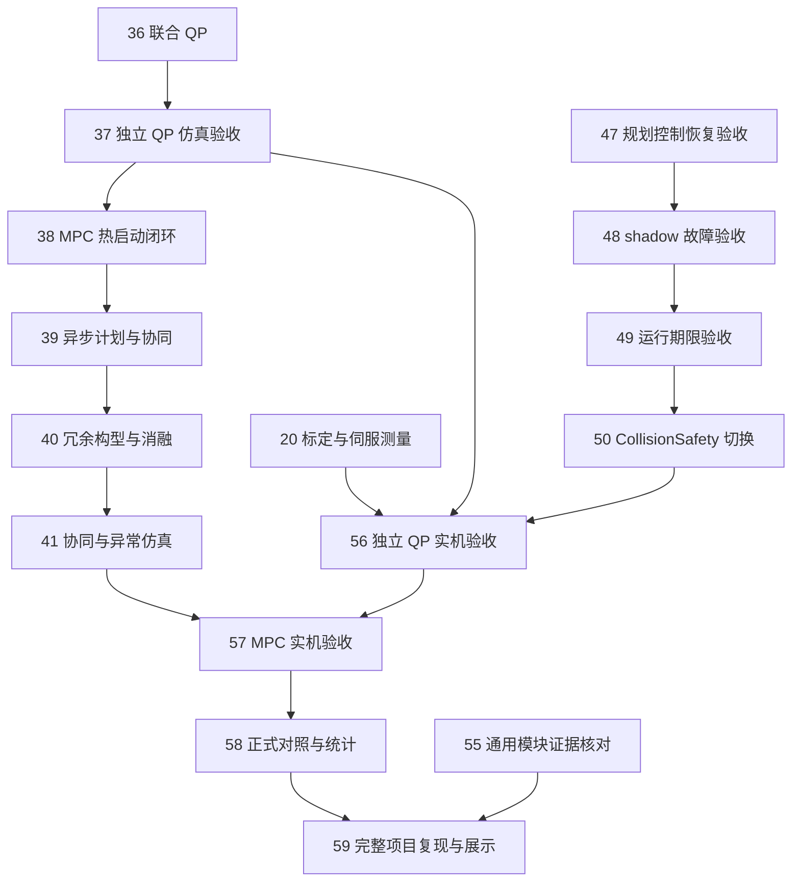

# 任务编号与阻塞关系

[完整项目地图](https://github.com/Shiningliu1011/nineaxis_safecontrol/issues/147)统一管理全部任务。标题采用 **01–72 连续编号**，按前置关系排序；GitHub 自身编号仅用于保持原链接与评论。

读取方法：某项任务的全部前置完成后，才能领取该任务。编号较小的任务可以仍在另一条分支进行；连续编号不要求所有任务逐项串行。下表列出直接前置，完整关系以 GitHub 原生 blocking 为准。已完成的历史证据保留在原任务中。

## 主要汇合关系

下图选取两条主要路线的真实依赖边。每项任务的全部前置见后面的表格。

## 准备与设计

| 任务 | 直接前置 |
|---|---|
| [01 核验完整项目基线与 M01–M12 资产](https://github.com/Shiningliu1011/nineaxis_safecontrol/issues/148) | 无 |
| [02 取得完整工件、路径与 MATLAB 程序资产](https://github.com/Shiningliu1011/nineaxis_safecontrol/issues/135) | 无 |
| [03 激光雷达外参标定与独立验收并写入真源](https://github.com/Shiningliu1011/nineaxis_safecontrol/issues/95) | 无；已领取，需要现场证据 |
| [04 完整项目技术复用与实施依赖](https://github.com/Shiningliu1011/nineaxis_safecontrol/issues/149) | 01 基线与资产 |
| [05 M02 九轴模型、TCP 与标定接口](https://github.com/Shiningliu1011/nineaxis_safecontrol/issues/136) | 01 基线与资产 |
| [06 M01 工件路径与五维任务参考](https://github.com/Shiningliu1011/nineaxis_safecontrol/issues/137) | 02 程序资产；05 模型接口 |
| [07 M07 公共限制与完整作业容差](https://github.com/Shiningliu1011/nineaxis_safecontrol/issues/138) | 06 路径参考 |
| [08 M03/M04 场景与预测碰撞接口](https://github.com/Shiningliu1011/nineaxis_safecontrol/issues/139) | 07 公共限制 |
| [09 M06 执行记录与共享进度结算](https://github.com/Shiningliu1011/nineaxis_safecontrol/issues/141) | 06 路径参考 |
| [10 全模块数据、时间与计划有效性](https://github.com/Shiningliu1011/nineaxis_safecontrol/issues/142) | 08 碰撞接口；09 进度结算 |
| [11 Runtime、安全监督与真实执行准入](https://github.com/Shiningliu1011/nineaxis_safecontrol/issues/151) | 01 基线；09 进度结算；10 数据与时间 |
| [12 M08 联合预测模型与求解方案](https://github.com/Shiningliu1011/nineaxis_safecontrol/issues/150) | 04 复用；05 模型；06 路径；07 限制；08 碰撞；10 数据与时间 |
| [13 初始逆解、入场退出与轨迹优化范围](https://github.com/Shiningliu1011/nineaxis_safecontrol/issues/140) | 04 复用；08 碰撞接口；09 进度结算 |
| [14 M09 联合 QP 与独立、协同运行规则](https://github.com/Shiningliu1011/nineaxis_safecontrol/issues/143) | 10 数据与时间；13 入场及轨迹范围 |
| [15 全项目验收、M12 与正式实验](https://github.com/Shiningliu1011/nineaxis_safecontrol/issues/144) | 14 联合 QP 定义 |
| [16 完整项目规格与验收追踪定稿](https://github.com/Shiningliu1011/nineaxis_safecontrol/issues/145) | 04 复用；11 执行准入；12 MPC 定义；15 验收方案 |

## 公共模块与独立闭环

| 任务 | 直接前置 |
|---|---|
| [17 实现 M01 工件、画笔、NURBS 与路径参考](https://github.com/Shiningliu1011/nineaxis_safecontrol/issues/152) | 02 程序资产；04 复用；06 路径定义 |
| [18 实现 M02/M07 共用模型、导数与约束](https://github.com/Shiningliu1011/nineaxis_safecontrol/issues/153) | 04 复用；05 模型；07 限制 |
| [19 实现 M11 真实设备协议与执行保护](https://github.com/Shiningliu1011/nineaxis_safecontrol/issues/164) | 01 基线；11 执行准入 |
| [20 完成 TCP、工件标定与伺服时序测量](https://github.com/Shiningliu1011/nineaxis_safecontrol/issues/165) | 11 执行准入；18 模型；19 设备协议 |
| [21 建立 LiDAR occupied/free/unknown 场景与固定模型并集](https://github.com/Shiningliu1011/nineaxis_safecontrol/issues/108) | 04 复用 |
| [22 实现逐点时间 mesh ray self-filter](https://github.com/Shiningliu1011/nineaxis_safecontrol/issues/105) | 04 复用；21 占据场景 |
| [23 建立动态 tracking 与 reachable support tube](https://github.com/Shiningliu1011/nineaxis_safecontrol/issues/101) | 04 复用；21 占据场景 |
| [24 实现 collision_scene_server 与双缓冲共享场景](https://github.com/Shiningliu1011/nineaxis_safecontrol/issues/104) | 04 复用；21 占据场景；22 自体过滤；23 动态 support |
| [25 实现独立 primitive query 行与固定容量活动集合](https://github.com/Shiningliu1011/nineaxis_safecontrol/issues/112) | 04 复用；23 动态 support |
| [26 实现自适应连续区间 certify](https://github.com/Shiningliu1011/nineaxis_safecontrol/issues/113) | 04 复用；23 动态 support |
| [27 独立几何与 kernel 正确性验收](https://github.com/Shiningliu1011/nineaxis_safecontrol/issues/125) | 04 复用；25 query；26 certify |
| [28 实现 M03/M04 工件场景与预测碰撞接入](https://github.com/Shiningliu1011/nineaxis_safecontrol/issues/154) | 08 碰撞定义；18 模型；25 query；26 certify |
| [29 实现 JAX multi-start IK 目标集合](https://github.com/Shiningliu1011/nineaxis_safecontrol/issues/111) | 04 复用；25 query |
| [30 实现共享 CollisionSafety 的九轴 AEB-RRT*](https://github.com/Shiningliu1011/nineaxis_safecontrol/issues/115) | 04 复用；26 certify；29 IK |
| [31 接入不可松弛碰撞 CBF 行与 deadline 准入](https://github.com/Shiningliu1011/nineaxis_safecontrol/issues/118) | 04 复用；24 场景服务；25 query |
| [32 实现 M05 状态快照与 M06 执行进度结算](https://github.com/Shiningliu1011/nineaxis_safecontrol/issues/155) | 09 进度定义；10 数据与时间 |
| [33 实现 M10/M11 仿真执行与最终指令校验](https://github.com/Shiningliu1011/nineaxis_safecontrol/issues/156) | 10 数据与时间；11 执行准入 |
| [34 实现独立作业 Runtime 与安全入场退出](https://github.com/Shiningliu1011/nineaxis_safecontrol/issues/158) | 13 入场定义；29 IK；30 AEB-RRT*；32 进度；33 执行 |
| [35 实现 M12 记录、回放与整段评价](https://github.com/Shiningliu1011/nineaxis_safecontrol/issues/159) | 10 数据与时间；15 验收方案 |
| [36 实现 M09 五维任务与进度联合 QP](https://github.com/Shiningliu1011/nineaxis_safecontrol/issues/157) | 14 QP 定义；17 路径；18 模型；28 工件碰撞；31 CBF；32 进度；33 执行 |
| [37 验收独立 QP 完整曲面仿真闭环](https://github.com/Shiningliu1011/nineaxis_safecontrol/issues/160) | 27 几何验收；34 Runtime；35 记录；36 QP |

## 预测协同与通用安全验收

| 任务 | 直接前置 |
|---|---|
| [38 实现 M08 联合 MPC 与热启动闭环](https://github.com/Shiningliu1011/nineaxis_safecontrol/issues/161) | 12 MPC 定义；37 独立 QP 验收 |
| [39 实现异步计划接收与上下层协同](https://github.com/Shiningliu1011/nineaxis_safecontrol/issues/162) | 10 数据与时间；34 Runtime；38 MPC |
| [40 实现未来冗余构型优化与消融入口](https://github.com/Shiningliu1011/nineaxis_safecontrol/issues/163) | 39 异步协同 |
| [41 验收双速率协同与动态异常仿真](https://github.com/Shiningliu1011/nineaxis_safecontrol/issues/166) | 23 动态 support；40 冗余构型 |
| [42 实现 JAX 完整任务轨迹优化](https://github.com/Shiningliu1011/nineaxis_safecontrol/issues/110) | 04 复用；13 适用范围；26 certify；30 AEB-RRT* |
| [43 接入最新场景复查、执行前视与风险触发重规划](https://github.com/Shiningliu1011/nineaxis_safecontrol/issues/116) | 04 复用；13 适用范围；24 场景；26 certify；42 轨迹优化 |
| [44 实现碰撞故障锁存与受限恢复](https://github.com/Shiningliu1011/nineaxis_safecontrol/issues/114) | 04 复用；26 certify；31 CBF；43 前视重规划 |
| [45 测量并冻结 CollisionParameterArtifact](https://github.com/Shiningliu1011/nineaxis_safecontrol/issues/117) | 03 外参标定；04 复用；24 场景；25 query；26 certify |
| [46 真实 LiDAR 回放与共享场景验收](https://github.com/Shiningliu1011/nineaxis_safecontrol/issues/122) | 04 复用；22 自体过滤；23 动态 support；24 场景；45 参数测量 |
| [47 MuJoCo 规划控制恢复闭环验收](https://github.com/Shiningliu1011/nineaxis_safecontrol/issues/127) | 04 复用；27 几何验收；31 CBF；43 前视；44 恢复；45 参数；46 回放 |
| [48 shadow 对照与故障注入验收](https://github.com/Shiningliu1011/nineaxis_safecontrol/issues/121) | 04 复用；47 规划控制验收 |
| [49 目标计算设备 deadline 与证据 manifest 验收](https://github.com/Shiningliu1011/nineaxis_safecontrol/issues/119) | 04 复用；45 参数；48 shadow |
| [50 切换 CollisionSafety 为唯一碰撞来源](https://github.com/Shiningliu1011/nineaxis_safecontrol/issues/123) | 04 复用；49 期限验收 |
| [51 移除旧碰撞运行路径与 fallback](https://github.com/Shiningliu1011/nineaxis_safecontrol/issues/124) | 04 复用；50 切换 |
| [52 同步速度级 OSCBF 基础模块文档](https://github.com/Shiningliu1011/nineaxis_safecontrol/issues/132) | 03 外参标定；已领取 |
| [53 同步 CollisionSafety 文档与配置入口](https://github.com/Shiningliu1011/nineaxis_safecontrol/issues/120) | 04 复用；51 旧路径处理；52 基础文档 |
| [54 核对速度级 OSCBF 基础模块证据](https://github.com/Shiningliu1011/nineaxis_safecontrol/issues/129) | 04 复用；52 基础文档 |
| [55 核对通用 OSCBF 与 CollisionSafety 证据](https://github.com/Shiningliu1011/nineaxis_safecontrol/issues/126) | 04 复用；53 碰撞文档；54 基础证据 |

轨迹优化与前视任务的适用范围由“完整项目技术复用与实施依赖”和“初始逆解、入场退出与轨迹优化范围”确定。基础独立 QP 与 MPC 的依赖没有经过完整离线轨迹优化任务。

## 实机、实验与交付

| 任务 | 直接前置 |
|---|---|
| [56 验收低速独立 QP 实机作业](https://github.com/Shiningliu1011/nineaxis_safecontrol/issues/167) | 03 外参；20 设备测量；37 独立 QP；45 参数；50 CollisionSafety 切换 |
| [57 验收 MPC 协同实机与受控动态作业](https://github.com/Shiningliu1011/nineaxis_safecontrol/issues/168) | 41 协同仿真；56 独立实机 |
| [58 完成正式对照、消融与统计实验](https://github.com/Shiningliu1011/nineaxis_safecontrol/issues/169) | 15 实验方案；16 完整规格；57 协同实机 |
| [59 验收完整项目复现与个人成果展示](https://github.com/Shiningliu1011/nineaxis_safecontrol/issues/170) | 16 完整规格；55 通用模块证据；58 正式实验 |

## 静态障碍物仿真实验

[60 静态障碍物仿真实验规格说明书](https://github.com/Shiningliu1011/nineaxis_safecontrol/issues/171)为已经确认的规格，提供以下 12 项任务的共同要求；[本地正文](../../specs/static-obstacle-experiments.md)及[实验入口说明](../../static_obstacle_experiments.md)保存在仓库中。

| 任务 | 直接前置 |
|---|---|
| [61 可重复的 S0 仿真与反馈评价](https://github.com/Shiningliu1011/nineaxis_safecontrol/issues/172) | 无 |
| [62 共享路径参考的五维跟随](https://github.com/Shiningliu1011/nineaxis_safecontrol/issues/173) | 61 仿真与反馈 |
| [63 单个静态障碍物的臂身避让](https://github.com/Shiningliu1011/nineaxis_safecontrol/issues/174) | 61 仿真与反馈 |
| [64 全部非相邻连杆的 mesh 自碰撞约束](https://github.com/Shiningliu1011/nineaxis_safecontrol/issues/175) | 63 外部避障 |
| [65 Ruckig 处理后的命令检查与进度结算](https://github.com/Shiningliu1011/nineaxis_safecontrol/issues/176) | 62 共享参考；64 自碰撞 |
| [66 S2–S5 场景及可行性见证](https://github.com/Shiningliu1011/nineaxis_safecontrol/issues/177) | 65 执行检查 |
| [67 构型调整与基础暂停恢复，形成 A 组](https://github.com/Shiningliu1011/nineaxis_safecontrol/issues/178) | 66 场景见证 |
| [68 进给与关节速度联合求解，形成 B 组](https://github.com/Shiningliu1011/nineaxis_safecontrol/issues/179) | 67 A 组 |
| [69 持续确认与渐增进给恢复，形成 C 组](https://github.com/Shiningliu1011/nineaxis_safecontrol/issues/180) | 67 A 组 |
| [70 Generalized-SNS 外部参考，形成 E 组](https://github.com/Shiningliu1011/nineaxis_safecontrol/issues/181) | 69 改进恢复 |
| [71 五组方法组合验证与统一周期测量](https://github.com/Shiningliu1011/nineaxis_safecontrol/issues/182) | 68 联合求解；70 外部参考 |
| [72 正式配对实验、论文图表与复现交付](https://github.com/Shiningliu1011/nineaxis_safecontrol/issues/183) | 71 方法与周期 |

62 与 63 可以分别推进，68 与 69 可以分别推进。规格作为各任务的定义来源，不增加未完成前置。

当前可新领取的起始工作是“核验完整项目基线与 M01–M12 资产”“取得完整工件、路径与 MATLAB 程序资产”和“可重复的 S0 仿真与反馈评价”。外参标定已由现有 Trellis 任务承接。新增任务或改变依赖后重新核对顺序，并同步本表；GitHub 原链接始终保留。
