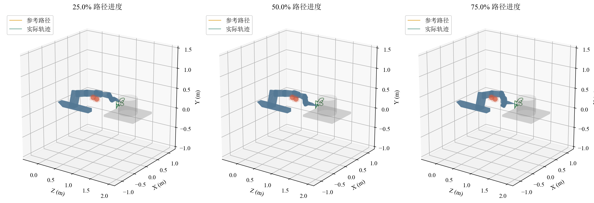
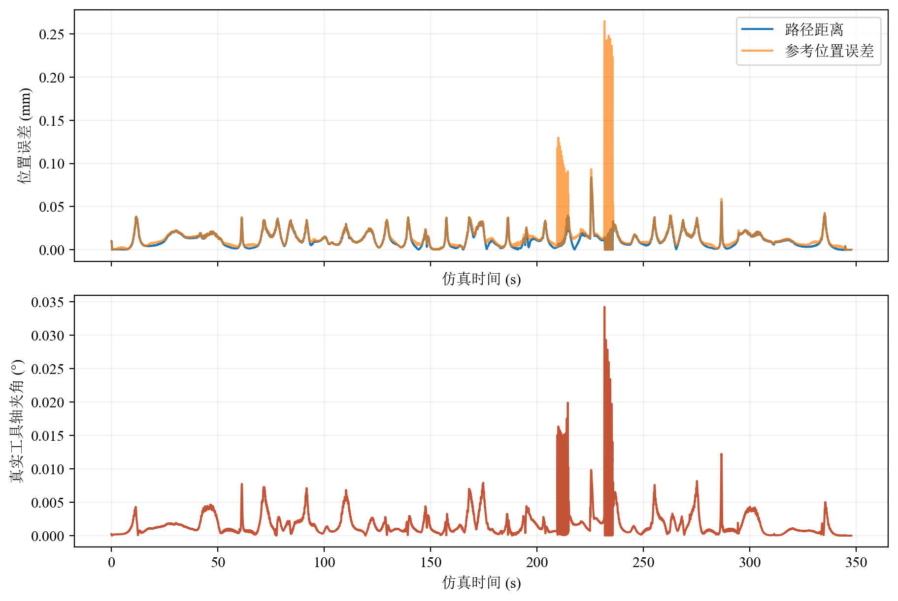
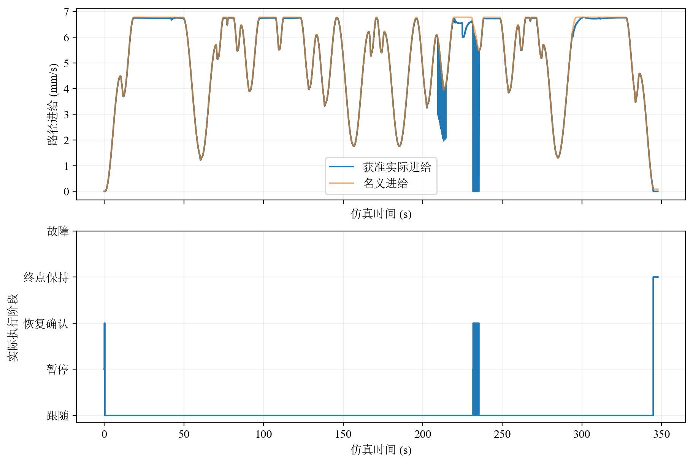
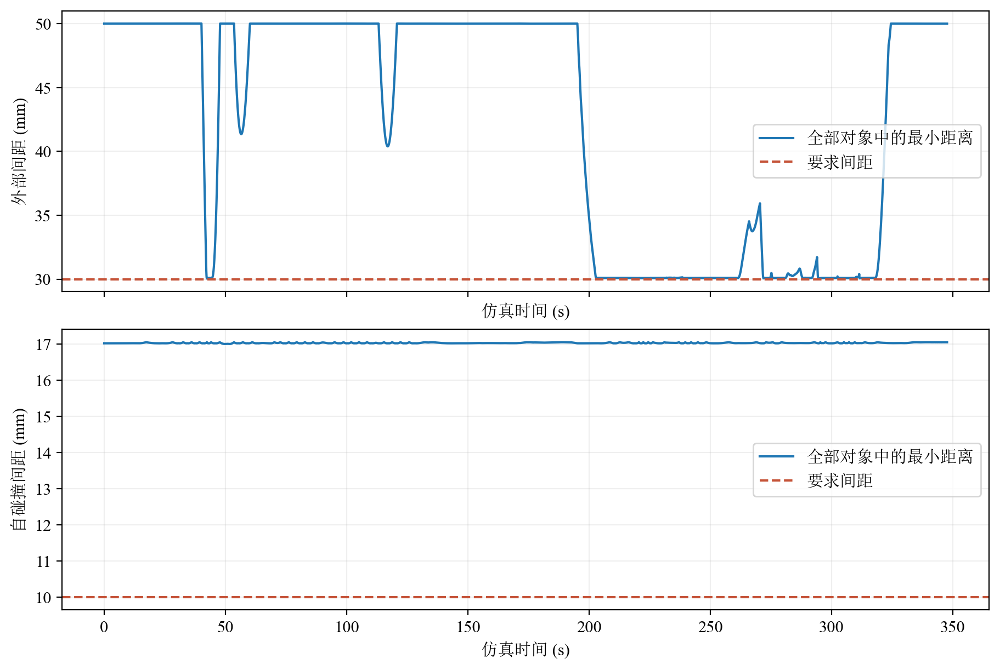
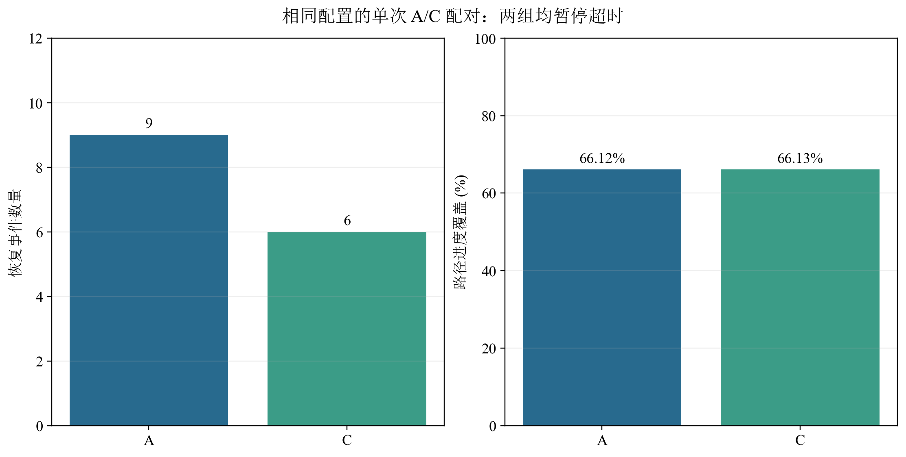

# 开题图片索引

全部图片位于仓库 `picture/proposal-static-obstacles/`，随当前分支同步。
中文字体为 SimSun，英文和数字为 Times New Roman。图注可直接修改后用于报告。
图片使用实际 sim 数据和模型生成，来源、字体身份、尺寸和 SHA-256 见各目录的 `figures.json`。

## 推荐展示图片

### 九轴机器人与双障碍场景

建议图注：九轴机器人在 S2 双障碍场景中的代表构型与 TCP 路径。数据来自 D 方法完整仿真记录，
控制周期 100 ms，采用开发名义进给。构型按路径位置选取，不表示相同时间间隔。

### S4 路径与工具轴误差

建议图注：D 方法在 S4 第三初态、半倍开发名义进给配置下的实际反馈误差。
路径距离 RMS 0.0148 mm，最大 0.0839 mm；工具轴真实夹角最大 0.0342°。
路径距离与参考位置误差采用不同定义，图中分别展示。

### S4 暂停与恢复

建议图注：同一 S4 配置下的参考进给与控制阶段，完整运行记录六次暂停后的恢复事件，最终完成路径。
这是单组仿真行为验证，不能据此推断全部配置的恢复成功率。

### S4 安全间距

建议图注：同一 S4 配置下的外部与非相邻连杆最小几何间距。
外部最小间距 30.053 mm，自碰撞最小间距 17.000 mm，分别满足 30 mm 和 10 mm 要求。

### 同配置恢复规则配对

建议图注：相同 S4 第一初态、相同进给和 100 ms 周期下，A/C 单次配对记录的恢复事件数量与实际路径进度。
两组均暂停超时；C 恢复事件数量由 9 次变为 6 次，不能解释为已经提高完整路径成功率。

## 全部图片

| 内容 | S0 | S2 | S4 |
| --- | --- | --- | --- |
| 机器人代表构型与路径 | [PNG](../../picture/proposal-static-obstacles/s0/representative-configurations.png) | [PNG](../../picture/proposal-static-obstacles/s2/representative-configurations.png) | [PNG](../../picture/proposal-static-obstacles/s4/representative-configurations.png) |
| 跟踪误差 | [PNG](../../picture/proposal-static-obstacles/s0/tracking-errors.png) | [PNG](../../picture/proposal-static-obstacles/s2/tracking-errors.png) | [PNG](../../picture/proposal-static-obstacles/s4/tracking-errors.png) |
| 进给与控制阶段 | [PNG](../../picture/proposal-static-obstacles/s0/feed-and-phase.png) | [PNG](../../picture/proposal-static-obstacles/s2/feed-and-phase.png) | [PNG](../../picture/proposal-static-obstacles/s4/feed-and-phase.png) |
| 外部与自身间距 | [PNG](../../picture/proposal-static-obstacles/s0/clearances.png) | [PNG](../../picture/proposal-static-obstacles/s2/clearances.png) | [PNG](../../picture/proposal-static-obstacles/s4/clearances.png) |
| 关节限制余量 | [PNG](../../picture/proposal-static-obstacles/s0/joint-margins.png) | [PNG](../../picture/proposal-static-obstacles/s2/joint-margins.png) | [PNG](../../picture/proposal-static-obstacles/s4/joint-margins.png) |
| 周期耗时 | [PNG](../../picture/proposal-static-obstacles/s0/cycle-duration.png) | [PNG，历史范围](../../picture/proposal-static-obstacles/s2/cycle-duration.png) | [PNG](../../picture/proposal-static-obstacles/s4/cycle-duration.png) |

S2 周期图采用历史计时范围，并在图内标注，不能用于当前完整周期资格。
S0、S4 来自当前固定运行源码；不同场景配置及来源见[数据与结论](results-and-conclusions.md)。

| 汇总图 | PNG | 可编辑 SVG | PDF |
| --- | --- | --- | --- |
| S0/S4 跟踪误差 | [PNG](../../picture/proposal-static-obstacles/summary/tracking-summary.png) | [SVG](../../picture/proposal-static-obstacles/summary/tracking-summary.svg) | [PDF](../../picture/proposal-static-obstacles/summary/tracking-summary.pdf) |
| 当前完整周期耗时 | [PNG](../../picture/proposal-static-obstacles/summary/cycle-summary.png) | [SVG](../../picture/proposal-static-obstacles/summary/cycle-summary.svg) | [PDF](../../picture/proposal-static-obstacles/summary/cycle-summary.pdf) |
| A/C 单次恢复配对 | [PNG](../../picture/proposal-static-obstacles/summary/recovery-pair.png) | [SVG](../../picture/proposal-static-obstacles/summary/recovery-pair.svg) | [PDF](../../picture/proposal-static-obstacles/summary/recovery-pair.pdf) |

S0/S4 跟踪汇总展示不同配置各自的误差，不用于因果比较。
周期图展示当前五份单次开发测量与 80 ms 门限，不表示已完成 A–E 共同周期选定。
汇总数据在 `docs/proposal-static-obstacles/data/metrics.csv`，绘图入口为 `scripts/plot_proposal_summary.py`。
