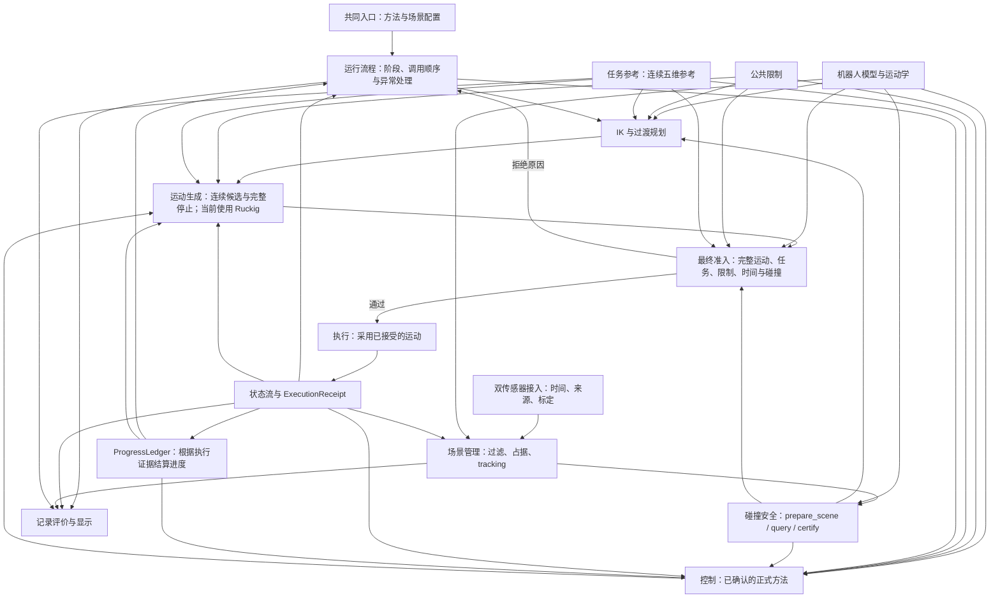

# 模块边界、复用与实现清理规格说明书

**状态**：本轮需求与测试入口已确认。实现与行为验收按本规格及既有专项任务推进；源码实施尚未开始。

## Problem Statement

维护者希望修改某个模块的内部实现时，其他模块能够继续通过稳定的接口使用它。当前模型、限制、碰撞、感知、规划、控制和执行能力分布在不同运行入口中，部分公共能力尚未被全部消费者采用；演示、实验与正式运行还存在各自维护计算和状态的情况。

维护者也需要准确知道每项能力实际使用哪种实现。已经选定 OBB 包络后，其他包络实现仍可被调用；不同入口对任务维度、碰撞范围、限制来源、参考进度和运动执行的处理存在差异。仅查看一个配置或文件，无法判断整个项目是否遵循已经确认的选择。

本轮需要明确模块职责和调用关系，整合共同能力，清理已经被替换且没有独立用途的实现，并通过实际运行和公共接口检查证明整合结果。

## Solution

各模块分别维护职责、代码和测试，通过公共接口协作。同一职责使用一个正式计算来源，规划、控制、执行和演示复用共同模型、限制、参考与场景。模块内部算法或资源变化且接口含义保持一致时，消费者继续使用既有接口。

本轮范围为现有功能的模块边界、公共能力复用、重复实现清理及必要替换接入。完整 MPC、预测协同、完整三方法算法与正式比较继续由既有任务实施。替换缺少必要前置时，记录对应依赖和未完成条目。

### 已确认要求

| 编号 | 要求 | 可观察的结果 |
|---|---|---|
| R01 | 各模块独立，通过公共接口协作 | 消费者不访问内部字段，不复制被调用模块的状态维护。 |
| R02 | 同一职责使用一个正式实现 | 方法与场景可以配置，实际业务计算来源清楚。 |
| R03 | 模型、限制、参考与场景具有明确来源 | 各消费者使用一致的身份、单位、时间和适用范围。 |
| R04 | 完整闭环通过共同入口装配 | 有效方法、场景和配置明确记录；未具备的方法明确拒绝。 |
| R05 | 机器人包络采用 OBB，碰撞使用共同接口 | 自碰撞与环境碰撞共用计算和结果含义，全部所需对象对参与。 |
| R06 | 清理被替换且没有独立用途的实现 | 入口、配置、安装资源与专用测试同步处理，有效行为覆盖保留。 |
| R07 | 移除独立 Python 规划 benchmark | 专用近似模型、稀疏碰撞和重复限值清除，正式 AEB-RRT* 保留。 |
| R08 | 速度、加速度、jerk 限制沿用已有决定 | QP 必要约束及实际完整运动检查具有残差与来源证据。 |
| R09 | 当前保留必要的 Ruckig 功能，以取消为目标 | 依赖集中在运动生成边界，取消前完成完整替代验收。 |
| R10 | 本轮聚焦现有功能整合 | 新增完整算法继续由原任务提供，替换前置与完成状态清楚。 |

## User Stories

1. 作为项目维护者，我希望每个模块具有明确职责，以便判断某项修改应该由哪个模块负责。
2. 作为模块维护者，我希望消费者通过公共接口使用模块，以便内部算法和存储方式调整时减少消费者修改。
3. 作为模块维护者，我希望公共接口的输入、结果和失败含义明确，以便准确判断修改的影响范围。
4. 作为项目维护者，我希望同一业务能力采用一个正式实现，以便保持计算规则和配置来源一致。
5. 作为项目维护者，我希望已经具备的公共能力被直接复用，以便减少重复计算与状态维护。
6. 作为项目维护者，我希望保留有明确用途的独立数值验算，以便检查正式实现的正确性。
7. 作为运行人员，我希望完整闭环通过共同入口选择方法和场景，以便使用一致的运行规则。
8. 作为运行人员，我希望尚未完成或验证的方法明确报告不可用，以便知道实际运行能力。
9. 作为演示维护者，我希望感知与过渡演示调用共同模块，以便演示行为与正式运行一致。
10. 作为设备检查人员，我希望单关节检查继续保持明确的独立用途，以便完成相应设备检查。
11. 作为运动学维护者，我希望关节、POE、TCP 和标定具有共同来源，以便各消费者使用同一个机器人模型。
12. 作为规划与控制维护者，我希望共同限制明确逐轴数值、单位和适用阶段，以便生成相容的运动。
13. 作为参考轨迹维护者，我希望位置、工具轴及其导数来自同一连续参考和进度，以便任务要求在各模块之间一致。
14. 作为碰撞维护者，我希望机器人采用已确认的 OBB 包络，以便实际计算遵循当前几何选择。
15. 作为碰撞维护者，我希望自碰撞与环境碰撞共用查询和区间证明，以便各消费者取得含义一致的结果。
16. 作为验收人员，我希望全部所需非相邻对象对和附件参与碰撞检查，以便验证完整机器人的约束范围。
17. 作为控制维护者，我希望碰撞结果包含有效导数、残差和状态，以便只采用满足要求的约束。
18. 作为感知维护者，我希望两路传感器分别保留时间、起点、标定和来源，以便正确使用各自观测。
19. 作为场景维护者，我希望共同场景由唯一负责对象维护并发布不可变结果，以便消费者读取一致的环境信息。
20. 作为运行人员，我希望传感器失效、覆盖不足和场景过期具有明确处理结果，以便依据有效信息继续或停止任务。
21. 作为规划维护者，我希望起点与逐点方法复用共同 IK 候选能力，以便保持模型、五维任务和限制一致。
22. 作为规划维护者，我希望正式 AEB-RRT* 继续提供连通路径搜索，以便保留已有规划能力。
23. 作为项目维护者，我希望移除独立 Python 规划 benchmark 及专用近似实现，以便减少需要维护的业务方法。
24. 作为控制维护者，我希望三种正式方法共用模型、参考、限制、场景和执行能力，以便比较由算法职责产生的差异。
25. 作为控制维护者，我希望速度、加速度和 jerk 的既有限制进入相应计算与运动检查，以便约束实际采用的运动。
26. 作为运动维护者，我希望 Ruckig 的依赖集中在运动生成内部，以便其他模块使用稳定的连续运动接口。
27. 作为项目维护者，我希望满足全部替代条件后取消 Ruckig，以便采用能够完整满足要求的共同方法。
28. 作为运行人员，我希望连续运动和停止功能在整合期间保持有效，以便现有功能具有经过验证的接续方式。
29. 作为执行维护者，我希望最终准入绑定具体运动、场景和有效时间，以便执行器采用经过检查的对象。
30. 作为控制维护者，我希望命令流与状态流分别声明来源，以便使用实际反馈计算后续动作。
31. 作为运行流程维护者，我希望进度根据执行证据结算，以便暂停、拒绝和停止余运动得到正确处理。
32. 作为运行人员，我希望求解失败、超时和命令中断具有明确结果，以便知道系统当前阶段和恢复条件。
33. 作为评价人员，我希望报告读取共同参考与已声明来源的执行记录，以便结果可以复现和比较。
34. 作为显示维护者，我希望显示只读取状态和场景，以便其更新不会改变命令生成。
35. 作为配置维护者，我希望启动时形成经过校验的有效配置快照，以便追踪参数来源和消费者实际取值。
36. 作为部署维护者，我希望源码、安装资源和实际入口采用相同正式来源，以便验证运行使用了预期实现。
37. 作为测试维护者，我希望通过真实入口和公共接口检查外部行为，以便模块内部整理后仍能复用有效测试。
38. 作为测试维护者，我希望几何、导数和完整运动具有独立正确性依据，以便数值问题能够被准确发现。
39. 作为项目维护者，我希望清理实现时同步处理配置、入口、资源和文档，以便项目呈现有效的运行选择。
40. 作为项目维护者，我希望缺少前置的替换明确记录未完成，以便准确安排后续工作。
41. 作为项目维护者，我希望本轮整合与完整 MPC 等专项任务具有明确边界，以便各项交付按原有要求继续进行。
42. 作为验收人员，我希望规格确认、软件行为通过和现场验证分别记录，以便准确判断证据适用范围。

## Implementation Decisions

### I01：独立职责

模块按业务职责组织，模块数量和文件数量不作为验收指标。ROS 节点与进程按输入输出和调度需要设置。

| 模块 | 负责内容 | 公共结果 |
|---|---|---|
| 机器人模型与运动学 | 关节身份、POE、TCP、标定、FK、Jacobian 与导数 | 带身份与有效范围的模型和运动学结果 |
| 公共限制 | 物理能力、作业限制、任务容差及阶段适用性 | 绑定模型与作业身份的限制 |
| 双传感器接入 | 各自采集时间、坐标、射线起点、标定、来源与输入健康 | 具有来源的观测 |
| 场景管理 | 按采集时刻过滤、固定实体、占据、tracking、误差与覆盖 | 完整不可变场景 |
| 碰撞安全 | OBB 几何、自碰撞、环境查询、时间影响与完整区间证明 | 场景准备、查询及证明结果 |
| 任务参考 | 连续路径、位置、工具轴及导数 | 同一进度上的五维参考 |
| IK 与过渡规划 | 候选构型、入场、退出及允许的连接规划 | 候选构型和待检查路径 |
| 控制 | OSCBF 与正式方法的求解职责 | 候选运动目标、残差和有效状态 |
| 运行流程 | 阶段、调用顺序、暂停、恢复及异常协调 | 当前阶段与执行请求 |
| 运动生成与执行 | 连续候选及停止、运动采用、状态反馈与执行记录 | 可查询的连续运动、实际状态及采用证据 |
| 最终准入 | 对具体运动复核任务、限制、场景、时间和停止条件 | 绑定运动与有效区间的通过或拒绝结果 |
| 记录评价与显示 | 读取已声明来源的数据，记录、评价与显示 | 报告、回放和显示结果 |

运行流程组织调用，各模块维护自身计算与状态。模型和限制计算保持独立于控制器、ROS 节点及显示组件。场景管理负责唯一写入，传感器接入、场景准备和控制查询分别调度。

### I02：公共接口与修改边界

- 优先复用 `NineaxisModel`、`ProcessLimits`、`BoundProcessLimits`、连续参考、共享场景及 `CollisionSafety` 的公开能力。新增接口必须对应真实消费者需要。
- 公共数据明确 shape、关节顺序、单位、坐标、物理时间、模型与配置身份、有效范围和状态。项目输入和报告使用 mm/°，计算边界使用 m/rad；转换集中在适配边界。
- 内部缓存、solver 对象、ROS node 和第三方库对象保留在所属模块。消费者通过公开输入和结果协作，场景和配置读取方使用只读数据。
- 内部实现改变且公共含义保持一致时，消费者源码应当保持可用，相关行为测试继续通过。公共输入、结果含义或时间规则改变时，列出消费者并同步适配和验证。
- 非法配置、shape、单位和程序调用在接口处立即报告。运行中的无效结果按既有状态、停止和恢复规则处理，诊断信息保留数值残差与原因。

### I03：配置、入口与方法选择

- 完整闭环使用已经确认的共同入口，感知、过渡及场景演示通过配置调用共同模块；单关节设备检查保留独立用途。
- 启动时共同装配、校验并记录有效配置快照和字段来源。运行中的受管参数按既有配置规则固定。
- `dt`、`dt_path`、发布频率与物理执行时间分别保持定义，转换记录依据；相同物理量具有一个明确来源。
- 方法标识为 `pointwise_ik`、`realtime_coordination`、`predictive_coordination`。各方法仅保留已确认的算法职责和自身求解状态，共用其他模块。
- 尚未具备定义或验证证据的方法明确报告不可用。方法名称、实现来源与实际能力需要一致；运行失败不得隐式调用另一套业务方法。

### I04：共同模型、限制与参考

- 关节身份、POE、TCP、标定、FK、Jacobian 和高阶导数共用来源。NumPy 与 JAX 可以承担各自必要计算或独立验算，机器人参数由共同模型维护。
- 物理能力与本次作业限额分别表达，通过绑定结果提供给规划、控制、运动与评价。逐轴限制沿用共同限制决定，不重新生成另一组默认值。
- 连续 NURBS 参考供起点、入场、控制、显示和评价查询。位置、工具轴及其导数使用同一进度与坐标变换。

### I05：碰撞与双传感器

- 机器人包络采用已有 OBB。自碰撞与环境碰撞共用 `CollisionSafety.prepare_scene/query/certify` 和结果含义。
- 当前十个本体 link 按拓扑生成 36 组非相邻对象对；工具和附件按归属扩展。要求间距为自碰撞 10 mm、环境 30 mm，通过几何外扩表达。
- 公共碰撞按专项规格提供 DCOL `h=alpha-1`、有效关节与时间导数、独立约束行、求解残差及完整区间证明。碰撞行不可松弛；米制距离另外表达其含义和验证范围。
- 双传感器分别保存采集时间、起点、标定、观测和误差。PCL、OctoMap、完整占据凸盒、采集时刻过滤及必要空间覆盖继续按碰撞专项接入。
- 场景服务发布完整不可变场景。规划、控制和执行验证身份与时效后消费共同结果；完整运动及停止的资格由相应覆盖和证明决定。
- 数值、导数、覆盖和完整周期通过相应专项验收后，公共碰撞才能承担对应运行模式的命令准入。

### I06：IK 与正式规划

- 起点与逐点方法复用已确认的五维 multi-start IK 候选接口，候选使用共同模型、任务、限制和场景。
- 现有正式 AEB-RRT* 搜索能力继续保留并接入公共模型、限制和碰撞；入场、退出与允许的重新规划使用共同规划服务。
- 已确认的 JAX trajectory optimization 继续按原任务实现和验收。优化结果通过相应区间证明后才能进入执行准入。
- 独立 Python 规划 benchmark 及其专用近似 FK、稀疏碰撞和重复限值纳入清理；仍被正式能力使用的公共计算保留。

### I07：OSCBF 与速度、加速度、jerk

- OSCBF 消费共同五维参考、模型、限制和碰撞结果。三种正式方法共用既有实时协调与执行条件，新增算法由原任务提供。
- 共同速度、加速度和 jerk 数组沿用 #138。#143 的已确认方案要求速度上限和局部可达速度范围进入 QP，加速度和 jerk 根据有效速度、加速度及周期形成必要约束。
- 实际连续运动、工具量和完整停止区间继续复核。约束名称与数学形式分别记录，目标速度变化限制的验证范围需要准确声明。
- 原始约束、数值残差和实际采用对象参与验收。失效、不可行或超期结果按已确认规则拒绝和处理。

### I08：Ruckig 的边界与取消条件

当前保留 Ruckig 支撑的必要位置跟随、连续跟踪、停止和规划时间处理，将依赖集中在运动生成边界。其他模块通过状态、时间及可查询的连续运动接口协作。

取消 Ruckig 是目标。取消前，替代实现必须同时满足：

1. 明确控制状态与控制变量，从有效 `q/qdot/qddot` 连续接续，提供完整 `q(t)`、速度、加速度和 jerk。
2. 所有执行区间及停止过程满足关节、工具、任务和碰撞要求，并证明区间内部与分段接续的有效性。
3. 求解不可行、超时、命令中断和状态失效时，具有符合既有要求的停止与保护处理。
4. 规划时间处理、仿真执行、运动证明、实际采用和进度结算使用相容的运动及时间。
5. 真实九轴仿真、相关异常、数值残差与完整周期通过验证，消费者、依赖与文档同步维护。

当前没有完成上述验收的替代实现，本轮保留必要功能。将约束改写为其他 CBF 形式或改变控制阶次需要相应数学与运行证据；本轮规格不预先指定未经验证的替代算法。

### I09：执行、反馈与进度

- 运行流程维护阶段、调用顺序及恢复条件；运动模块生成连续候选和完整停止；最终准入核验具体运动；执行器采用已接受对象并返回证据。
- 命令流与状态流分开，状态明确其仿真、回放、在线观测或设备反馈来源。实际执行记录确认已采用运动，进度根据执行证据结算。
- `ExecutionReceipt`、`ProgressLedger` 及完整 Runtime 的新能力由原任务提供。本轮集中现有运动与状态维护，在具备证据后接入公共对象。
- 显示与评价只读取已声明来源的数据。暂停、拒绝、停止余运动、状态接续和恢复按既有规则验证。

### I10：保留与清理

保留正式规划和控制能力、共同模型与参考、有效感知和场景处理、必要运动与停止功能、独立数值验算、单关节设备检查及原始研究证据。

完成替换并验证后，清理以下业务实现及对应入口、配置、安装资源和专用测试：

- 已被 OBB 公共碰撞替代的椭球计算与专用几何配置。
- 已被共同碰撞替代的距离、球体、ESDF 及静态实验准入分支。
- 已被共同五维候选替代的 KDL、PSO 业务调用。
- 独立 Python 规划 benchmark 及其专用近似模型、稀疏碰撞与重复限值。
- 已被共同入口替代的六维感知演示、直接采用 `q_next` 的执行路径及无独立用途的历史方法选择。
- 消费者复制的模型参数、参考变换、限制计算、场景维护和进度更新。

清理按符号、调用方和有效用途确定。仍有效的场景与断言迁入公共接口测试，当前运行文档描述实际可用选择。

### I11：替换与完成状态

每项替换明确现有能力、共同接口、消费者、必要前置及验收结果。仍支撑现有功能的实现，在替代能力通过对应验证后移除。

某项前置不足时，该替换保持未完成，其余独立条目可以继续验证。专项算法的完成状态依据原任务证据；规格确认、源码修改、行为通过和现场验收分别记录。

## Testing Decisions

### 验收入口与原则

用户已确认：主要集成验收入口为正式运行采用的真实 final launch 及有效配置。完整仿真闭环使用实际仿真被控对象产生状态流，通过公共命令、反馈、诊断、执行记录和报告检查结果。

复用已有公共模块接口完成必要数值与边界检查，重点包括模型和导数、连续参考、公共限制、`CollisionSafety.prepare_scene/query/certify`、连续运动及停止。模块内部文件调整不产生新的测试专用接口。

测试检查公开结果与实际行为，不依赖私有函数排列、内部字段布局或调用次数。数值正确性使用解析关系、独立模型、高精度计算及有依据的区间证明；使用真实计算库、数据和进程，仿真来源明确。模块之间共享实现的要求另外核对实际导入、配置传播与安装资源。

### 验收矩阵

| 编号 | 对应要求 | 输入与行为 | 通过条件 |
|---|---|---|---|
| T01 | R01、R02 | 真实消费者调用共同接口，检查模型、场景、控制及运动结果 | 依赖方向符合职责，消费者不读取内部缓存或第三方运动对象。 |
| T02 | R01、R03 | 使用真实资源变更几何、参考或限制，按公共接口运行消费者 | 语义稳定的内部变化无需消费者复制计算；有语义影响的变更具有完整消费者验证。 |
| T03 | R02、R04、R06、R07 | 源码、安装资源、正式入口和清理对象的调用检查 | 正式来源一致，无失效入口或无用途业务分支；正式 AEB-RRT* 继续有效。 |
| T04 | R03、R04 | 有效配置、单位、坐标、时间与身份变化，运行中参数变更请求 | 字段真实传播到消费者和报告；非法或身份失配输入得到明确拒绝。 |
| T05 | R03 | 真实机器人 FK、Jacobian、导数、限制及连续五维参考 | 通过独立核验；位置与工具轴使用同一进度，限制来源和适用阶段一致。 |
| T06 | R05 | 双源输入、共同场景、自碰撞、环境碰撞、完整区间及来源失效 | 通过对应碰撞专项前置；规划、控制和执行使用相同几何、场景及结果含义。 |
| T07 | R08、R09 | 原始约束、连续运动、停止、拒绝、超时、命令中断和状态接续 | 实际采用运动满足要求；Ruckig 保留期间必要能力完整，取消须满足 I08 全部条件。 |
| T08 | R04、R10 | 各可用方法与演示、状态来源、执行进度及评价结果 | 已具备能力如实声明，未具备方法明确拒绝；评价与进度使用声明的执行证据。 |
| T09 | R06、R10 | 受影响公共接口、实际安装入口和真实仿真闭环回归 | 有效功能与断言完整保留，运行、配置、模块和验收文档一致。 |

### 可复用的测试基础

| 已有测试基础 | 本轮沿用的验证方式 |
|---|---|
| final launch 运行测试、控制器 smoke 测试 | 复用真实进程、服务和命令接口，补充本轮接入所需的实际仿真反馈与结果检查。 |
| 共同机器人模型与限制测试 | 复用 MuJoCo 独立模型、逐轴输入、单位转换、配置身份及阶段规则检查。 |
| 连续参考与共享轨迹变换测试 | 复用原始轨迹、独立导数、连续投影、暂停和输入拒绝检查。 |
| 公共碰撞、场景准备及共享场景测试 | 复用公开查询、身份、时间、真实共享进程和失效处理，扩展到相应替换要求。 |
| 连续运动与执行测试 | 复用独立运动计算、状态接续、完整停止和执行进度核验。 |
| 评价与报告测试 | 复用实际误差、真实工具轴角度、记录来源和报告一致性检查。 |

现有测试提供对应范围的基础，不直接代表全部 T01–T09 已通过。完整周期沿用项目的统计与物理期限要求；碰撞专项的容量、容差、区间证明、回放和在线条件保持有效。缺少条件的项目明确记录未验证，全部失败与未完成情况保留在验收证据中。

## Out of Scope

- 本轮整合中新增完整 MPC、预测协同、完整三方法算法与正式比较；这些能力继续由原任务交付。
- 通过本轮规格重新选择共同限值、五维任务定义或正式比较方法。
- 在缺少数学和运行证据时，指定取消 Ruckig 的新控制阶次或求解方法。
- 本次规格生成与发布中的源码实施、依赖安装、仿真运行、设备动作、代码提交和远程代码推送。
- 解除真实硬件准入限制，或将仿真和软件测试结果视为真实设备运行资格。
- 另建执行地图、重复创建算法实现任务或调整既有任务完成状态。

## Further Notes

### 已确认决定与入口

- Q01：完整闭环入口为 `run_demo.sh`，显式选择方法与场景；演示复用共同模块。
- Q02：清理已经被替换且无独立用途的实现，保留必要验算和设备检查。
- Q03：现有功能整合与必要替换接入；新增完整算法按既有任务实施。
- Q04：移除独立 Python 规划 benchmark，保留正式 AEB-RRT*。
- 用户补充：各模块独立，通过公共能力协作；以取消 Ruckig 为目标，暂时无法取消时保留必要功能。

### 实施依赖

| 本轮接入内容 | 既有能力或必要前置 |
|---|---|
| 模型、限制与连续参考 | #152、#153 的共同能力及消费者验证 |
| 双传感器与公共碰撞 | #196 管理专项要求；对应查询、连续证明、覆盖与周期证据 |
| 五维 IK 与正式规划 | #111、#115 提供相应替换能力 |
| 状态、连续运动与执行记录 | #155、#156 提供相应公共接口和完整运动检查 |
| OSCBF 与必要约束 | #138、#143 管理已确认要求，#118、#157 等提供对应新增算法 |
| 完整 Runtime 与新增评价 | #158、#159 提供对应能力 |
| 新增 MPC 与正式比较 | #150、#161、#162、#163、#166、#110、#169 等原任务继续负责 |

依赖表示对应替换的前置，不表示这些任务已经完成。执行前按实际源码和验证证据核验所需能力。

### 模块调用流程

该图表达目标关系。各节点表示独立职责，正式方法与完整公共对象的新增能力按前置条件接入。

准入拒绝后，运行流程按当前已接受运动的停止和异常规则处理。显示与评价只读取数据。反馈与进度可以经运行流程传入消费者，来源保持明确。

### 决定来源

- [九轴曲面作业完整项目 #147](https://github.com/Shiningliu1011/nineaxis_safecontrol/issues/147)：既有任务归属及整体要求。
- [共同速度、加速度和 jerk 限制 #138](https://github.com/Shiningliu1011/nineaxis_safecontrol/issues/138)：各方法与实际运动共同使用的限制。
- [联合 QP 完整方案 #143](https://github.com/Shiningliu1011/nineaxis_safecontrol/issues/143#issuecomment-6442638255)及[确认记录](https://github.com/Shiningliu1011/nineaxis_safecontrol/issues/143#issuecomment-6442700214)：必要约束、实际运动与停止复核、对应实现分工。
- [DCOL 与双传感器专项 #196](https://github.com/Shiningliu1011/nineaxis_safecontrol/issues/196)：几何外扩、公共碰撞、场景、覆盖、连续证明及完整周期。本轮机器人包络明确采用 OBB。

当前规格由会话确认结果、源码调用关系、现有测试和上述资料整理。模块整合的实现证据、算法验收及现场验证按各自范围记录。
